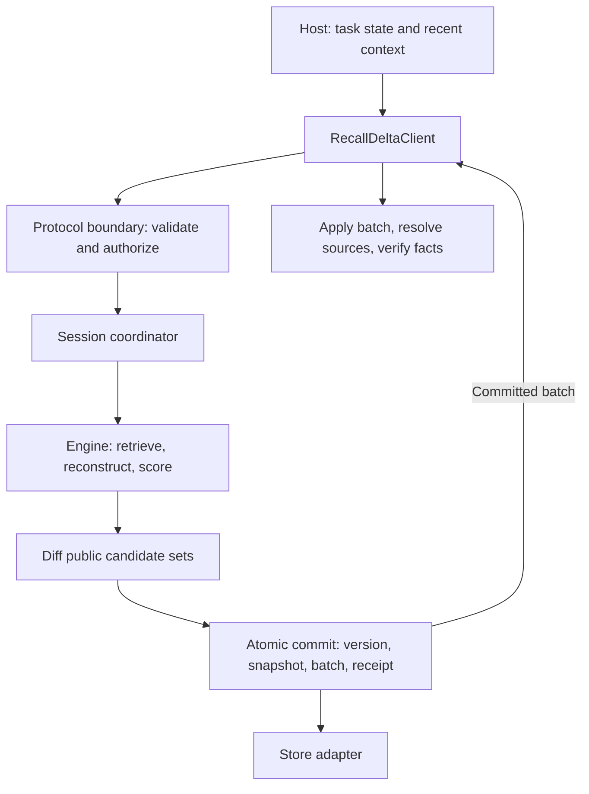
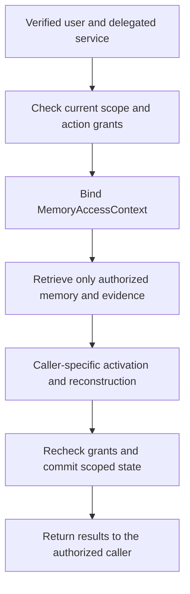
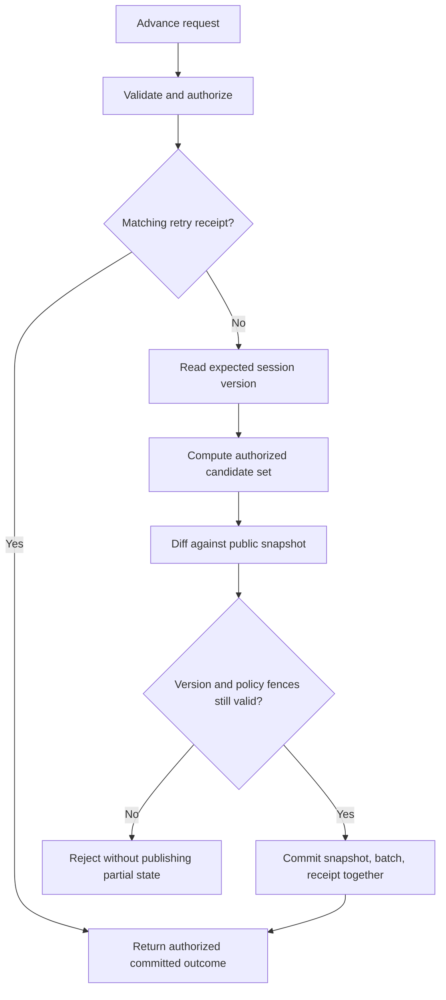
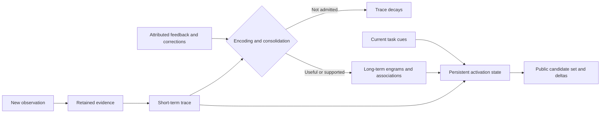

# Part II — Conceptual TypeScript implementation

This section illustrates the [language-neutral protocol](../spec/recall-delta-protocol.md). The protocol owns observable behavior; these TypeScript types and implementation choices are explanatory. There are no published packages or implemented storage adapters.

## 1. Boundaries



*Figure 1. A possible TypeScript architecture. Engine decisions are separate from protocol validation and atomic session delivery. A store adapter must uphold the advertised contract.*

The host can call an in-process implementation or a future transport adapter. Neither the host nor protocol requires Skein, LangGraph, a particular LLM, or a particular database.

## 2. A possible host-facing interface

The request/result names below refer to the records and operation table in Part I. This is interface notation, not a complete compilable SDK declaration; concrete authentication and error wrappers belong to a binding.

```ts
interface RecallDeltaClient {
  describe(): Promise<Capabilities>;
  observe(request: ObserveRequest): Promise<ObservationReceipt>;
  readEvidence(request: EvidenceRequest): Promise<EvidenceResult>;
  openSession(request: OpenSessionRequest): Promise<Snapshot>;
  advanceSession(request: AdvanceSessionRequest): Promise<Batch>;
  readSession(request: SessionRequest): Promise<Snapshot>;
  readDeltas(request: DeltaReadRequest): Promise<DeltaPage>;
  recordFeedback(request: FeedbackRequest): Promise<FeedbackReceipt>;
  closeSession(request: CloseSessionRequest): Promise<Batch>;
}
```

The host first ingests relevant observations, then explicitly chooses which sessions to advance. The evidence write does not itself emit a session update. A new advance replaces cues, supplies contextual evidence IDs, and includes the last known session version and a stable retry ID.

After a successful advance the host applies the whole batch. It resolves source evidence before relying on a recalled operational fact. If a batch is missing or malformed it reads a complete snapshot. After a timeout it retries the same request ID within the advertised retry window; it does not invent a second request ID to repeat an uncertain mutation.

### Trusted caller and scoped clients

For an agent serving multiple people, the authentication boundary establishes the effective user and any acting service before binding a client to one tenant/scope. A possible internal shape is:

```ts
interface MemoryAccessContext {
  tenantId: string;
  principalId: string;
  actingServiceId?: string;
  agentId: string;
  scopeId: string;
  authorizationVersion: string;
}
```

This is server-owned context, not additional fields the model is trusted to populate. The binding verifies identity, delegation, tenant membership, the selected scope, and permission for each operation. authorizationVersion represents a service-validated policy/grant revision; it is not authority merely because a caller supplied a string. These TypeScript fields enforce no security by themselves.

Alice and Bob can use the same agentId while their user-private memories, feedback, and activation remain isolated. A memory mentioning Bob does not make Bob its owner or reader. A caller selecting a group-shared scope needs current membership and action-specific permission; a shared read does not imply a shared write.



*Figure 2. A conceptual authorization path before recall. Model-generated identity fields cannot bypass it. Each output and commit must still satisfy current access policy.*

One session remains bound to one principal and scope. To combine Alice's private experience with approved team knowledge, the host keeps separate private-scope and team-scope sessions, then assembles an Alice-only working context. It preserves tenant/scope/session/candidate identity alongside each result and does not persist the mixed context into team memory. The core sketch's reducer works only after the caller/session binding has been checked; its sessionId check is not authorization.

## 3. A minimal session coordinator

An implementation would need to perform these steps for `advanceSession`:



*Figure 3. Conceptual advance path. Validation failures, key conflicts, terminal states, and bounds also reject the request; the diagram highlights retry handling and the final commit boundary.*

1. Validate the input and establish trusted caller context; authorize the scope, action, session owner, and references.
2. Look up the retry receipt. Return a prior committed outcome only if the logical payload matches and access still permits it.
3. Read the session at `expectedVersion` and reject terminal/expired sessions.
4. Retrieve authorized candidates, evidence, and graph edges using the current cues; unauthorized state never enters scoring or reconstruction.
5. Reconstruct or select content and compute engine-local estimates.
6. Apply emission policy, including any threshold, rounding, candidate cap, or hysteresis.
7. Diff the last committed public set against the new public set.
8. Atomically compare the version and commit the new snapshot, batch, and retry receipt.
9. Return the committed batch. A receipt for merely queued work is not a completed advance.

Expensive scoring can run outside a store transaction against an explicit read view, but the final compare-and-swap must reject a stale session. A service must also recheck any authorization/retention changes before committing candidate payloads; a version match alone does not make stale evidence safe to publish.

The standalone [session reducer](../conceptual/recall-session.ts) demonstrates only public-set diffing and client application. It uses discriminated unions for emerged/updated/withdrawn candidates and rejects a missing version, mismatched profile, duplicate change, or invalid candidate transition without partial local mutation.

Its deliberate omissions are authentication, runtime shape/range checks, persistence, retry receipts, history hashes, concurrency control, actual recall, and learning. The reducer cannot detect a conflicting duplicate historical batch without retained history. The host/service must supply these missing boundaries; the file is not core-conforming on its own.

The sketch can be type-checked without installing a project:

```sh
tsc --noEmit --strict --target ES2022 --module ES2022 conceptual/recall-session.ts
```

## 4. An illustrative deterministic engine

The conceptual engine preserves the [originating goal](design-context.md): remembering and a persistent, fallible recall process. It has internal activation state as well as a host-visible candidate set. Those are different: a memory can be weakly active internally without crossing the threshold for public emergence.



*Figure 4. A conceptual memory lifecycle, not a mandatory core architecture. Temporary traces and durable engrams both feed recall. Trace decay does not erase retained evidence; evidence deletion is governed separately by policy.*

A possible internal vocabulary would be:

```ts
interface MemoryTrace {
  id: string;
  evidenceIds: string[];
  features: string[];
  expiresAt: string;
  salience: number;
}

interface Engram {
  id: string;
  kind: "episodic" | "semantic" | "procedural" | "preference";
  interpretation: Json;
  evidenceIds: string[];
  stability: number;
}

interface Association {
  fromMemoryId: string;
  toMemoryId: string;
  relation: string;
  weight: number;
}

interface EngineSessionState {
  activationByMemoryId: Record<string, number>;
  lastAdvancedAt: string;
}
```

These are internal explanatory records, not a portable bundle schema. A concrete engine must attach tenant/scope ownership, source-policy dependencies, revision history, and concurrency controls. EngineSessionState is keyed by caller and scoped session; two users reading the same shared engram do not share activation. Associations cannot connect unauthorized objects or silently cross scopes. A candidate can reconstruct several memories, so candidate identity need not equal an engram ID.

The smallest experiment can use explicit entity/keyword cues and evidence-backed memory records. Each advance retrieves a bounded pool, carries forward internal activation, computes updated scores, retains candidates over an emission threshold, and reports the difference from the previous public set. A complete engine would atomically commit its internal EngineSessionState together with the public snapshot and batch so retries do not apply activation twice.

For discussion, accessibility could use a retention term:

```text
decayed = previousActivation × exp(-decayRate × elapsedTime)
activation = clamp(decayed + directCueSupport + boundedAssociationSupport
                   - competingCandidatePenalty, 0, 1)
```

This is an illustrative algorithm, not a protocol requirement or a validated cognitive model. It at least makes the no-input decay behavior explicit: without cues or association support, positive decay lowers previous activation. Units, candidate budgets, time source, association normalization, and thresholds must be specified for an actual engine.

Factual confidence is calculated separately from activation. Changing warehouse cues can reduce relevance without changing confidence that the old incident happened. Confirmation may increase factual confidence only under an attributable feedback policy. Repeated recalls alone cannot supply that basis.

Do not add randomness to establish protocol compliance. If stochastic recall becomes useful experimentally, isolate it behind an optional profile and compare it against the same engine without noise. A seed alone cannot reproduce external models, approximate search, wall-clock changes, or concurrent writes.

An initially wrong candidate can arise deterministically because two incidents share incomplete cues. A later disambiguating cue can weaken that candidate and surface the other one. This satisfies the intended fallibility without inventing false evidence. Deliberately introducing additional variability is a separate research choice, not excluded from the project or required by the protocol.

## 5. Storage and transactions

One possible internal model has separate repositories for evidence, derived memory records, feedback, sessions, batches, and retry receipts. Traces and weighted associations can be introduced by an engine profile; they need not become mandatory wire objects.

An internal store abstraction could expose one operation such as:

```ts
interface SessionCommit {
  access: MemoryAccessContext;
  requestId: string;
  requestFingerprint: string;
  expectedVersion: number;
  snapshot: Snapshot;
  batch: Batch;
}

interface SessionStore {
  commitAdvance(input: SessionCommit): Promise<CommitResult>;
}
```

The commit's contract includes version comparison and atomic receipt/snapshot/history visibility. A concrete store also needs an authorization/retention fence or equivalent protected read/commit boundary, not represented by this abbreviated interface. `requestFingerprint` must be computed over a specified canonical logical payload; ordinary `JSON.stringify` of arbitrary key order is not a sufficient cross-client definition. A future binding can choose a canonicalization scheme.

SQLite would be a reasonable single-process experiment. A filesystem adapter would need specified locking, append durability, recovery, and receipt behavior. PostgreSQL could support concurrent clients. These are engineering options, not delivered capabilities. A `transactions: false` flag cannot excuse partial success under a core operation that promises atomic acknowledgement.

Tenant/scope checks must cover evidence, blobs, memory records, associations, sessions, receipts, caches, and worker jobs. A filesystem path containing userId is not sufficient unless the adapter constrains path resolution and access. A shared-table PostgreSQL adapter can add row-level policies as another enforcement layer; its request role must not silently bypass those policies through owner/superuser privileges. See [PostgreSQL's row-security documentation](https://www.postgresql.org/docs/current/ddl-rowsecurity.html). No such adapter is implemented here.

## 6. Corrections and learning

A correction is first an observation with its own source record. `recordFeedback` targets the candidate at a known committed version, references that record, and returns a receipt. The encoding/learning policy may later revise a durable interpretation, preserve both conflicting interpretations, or defer judgment.

The next explicit advance reconstructs public candidates against the updated memory and emits an update or withdrawal. Evidence keeps the original statement and its correction while policy permits retention. A successful task outcome can support utility; it does not validate every factual claim recalled along the way.

The protocol does not require learning from every feedback record, and does not define how a source proves independence. Those are design and evaluation responsibilities rather than consequences of TypeScript types.

Consolidation must also preserve the audience of its evidence. A private experience may produce a private procedure or preference; changing it into a generic-sounding sentence does not make it team knowledge. A derivative's effective access cannot exceed the intersection of its source policies, and the source dependencies must remain traceable for later revocation.

When Alice finds a shared memory useful, her feedback and any resulting personalization stay caller-specific by default. They do not automatically increase shared confidence or change association weights used by Bob. Shared learning needs separately authorized shared input and a defined policy. Promotion of private content requires an explicit sharing workflow; its interoperable operation is not defined in this draft. Until then the host keeps mixed private/shared interpretations in caller-private context.

## 7. What would make the experiment convincing?

Build one small deterministic implementation and one independently written implementation, then exercise one host against both. Use the same observation fixtures and vary cue sequences, contradictory sources, retries, and missed batches. Compare against:

- Stateless retrieval with the same retrieval budget and a client-side set diff.
- Full recent context under the same token budget.
- The same engine with session activation disabled.

Measure candidate relevance, abstention, correction latency, stale-recall use, factual grounding, host task results, cost, and latency. Session state and delta delivery must earn their complexity; neither is evidence of better memory by itself.
