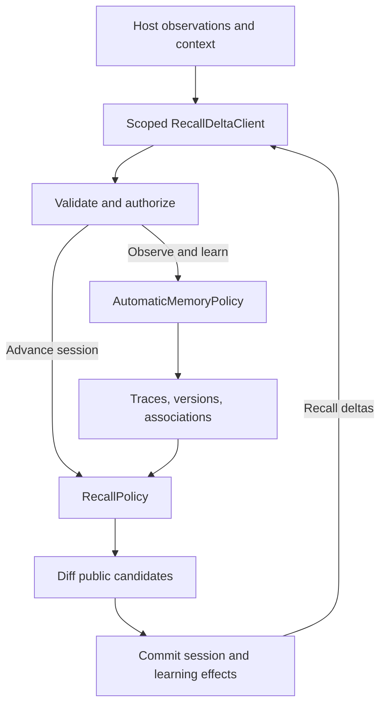
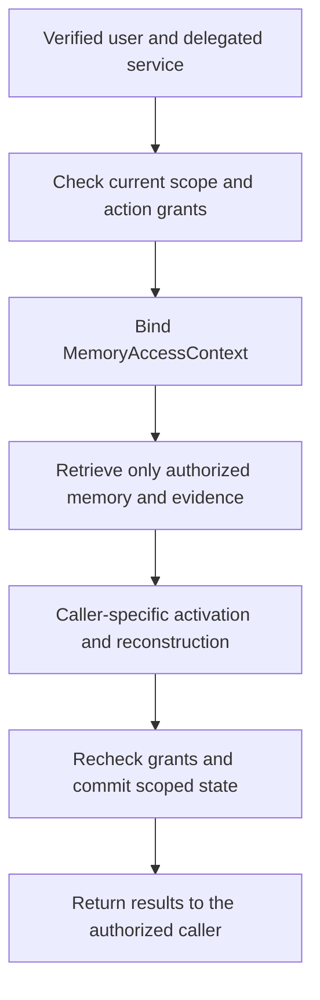
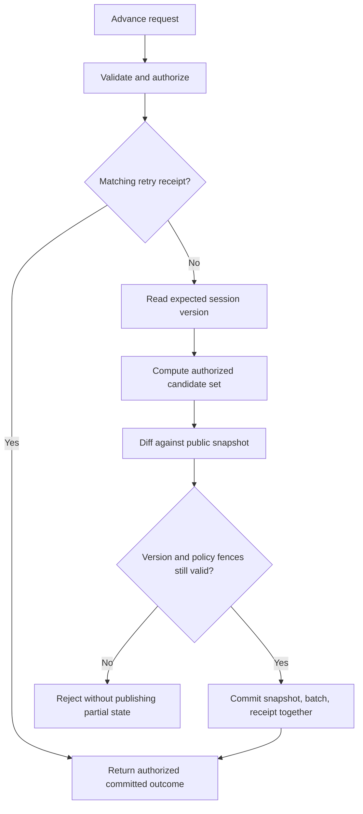
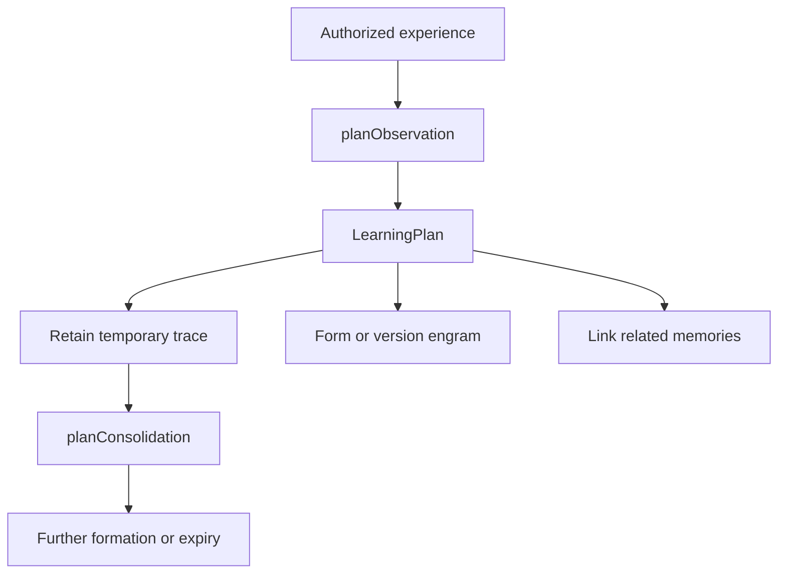
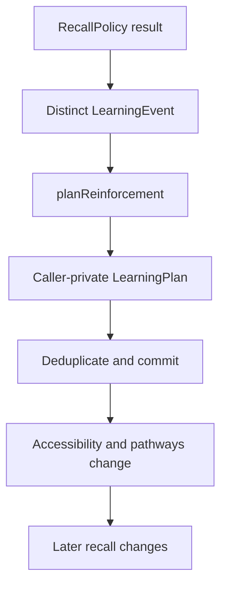

# Part II — Conceptual TypeScript implementation

This section maps the [evolving associative memory model](../spec/recall-delta-protocol.md#1-definition-and-memory-model) to a possible TypeScript engine. Experiences form traces and engrams; context activates associations; reinforcement changes future accessibility; new experiences produce revisions and temporal history. The protocol owns observable exchange behavior. These types and implementation choices are explanatory, with no published SDK, storage adapter, or complete engine.

## 1. Boundaries



*Figure 1. Formation and recall are separate engine paths over the same authorized memory. The admission receipt confirms retained evidence; processing may continue through a lifecycle worker. Session deltas are emitted only after an explicit advance commits.*

The host can call an in-process implementation or a future transport adapter. Neither the host nor protocol requires Skein, LangGraph, a particular LLM, or a particular database.

## 2. A possible host-facing interface

The request/result names below refer to the records and operation table in Part I. This is interface notation, not a complete compilable SDK declaration; concrete authentication and error wrappers belong to a binding.

```ts
interface RecallDeltaClient {
  describe(): Promise<Capabilities>;
  observe(request: ObserveRequest): Promise<ObservationReceipt>;
  readEvidence(request: EvidenceRequest): Promise<EvidenceResult>;
  openSession(request: OpenSessionRequest): Promise<Snapshot>;
  advanceSession(request: AdvanceSessionRequest): Promise<Batch>;
  readSession(request: SessionRequest): Promise<Snapshot>;
  readDeltas(request: DeltaReadRequest): Promise<DeltaPage>;
  recordFeedback(request: FeedbackRequest): Promise<FeedbackReceipt>;
  closeSession(request: CloseSessionRequest): Promise<Batch>;
}
```

The host ingests observations without choosing every memory to remember or forget. The engine's automatic policy owns formation, linking, reinforcement, and consolidation. The host separately chooses when task context warrants a recall-session advance. Admission does not itself emit a session update or claim completed consolidation. A new advance replaces cues, supplies contextual evidence IDs, and includes the last known session version and a stable retry ID.

After a successful advance the host applies the whole batch. It resolves source evidence before relying on a recalled operational fact. If a batch is missing or malformed it reads a complete snapshot. After a timeout it retries the same request ID within the advertised retry window; it does not invent a second request ID to repeat an uncertain mutation.

### Trusted caller and scoped clients

For an agent serving multiple people, the authentication boundary establishes the effective user and any acting service before binding a client to one tenant/scope. A possible internal shape is:

```ts
interface MemoryAccessContext {
  tenantId: string;
  principalId: string;
  actingServiceId?: string;
  agentId: string;
  scopeId: string;
  authorizationVersion: string;
}
```

This is server-owned context, not additional fields the model is trusted to populate. The binding verifies identity, delegation, tenant membership, the selected scope, and permission for each operation. authorizationVersion represents a service-validated policy/grant revision; it is not authority merely because a caller supplied a string. These TypeScript fields enforce no security by themselves.

Alice and Bob can use the same agentId while their user-private memories, feedback, and activation remain isolated. A memory mentioning Bob does not make Bob its owner or reader. A caller selecting a group-shared scope needs current membership and action-specific permission; a shared read does not imply a shared write.



*Figure 2. A conceptual authorization path before recall. Model-generated identity fields cannot bypass it. Each output and commit must still satisfy current access policy.*

One session remains bound to one principal and scope. To combine Alice's private experience with approved team knowledge, the host keeps separate private-scope and team-scope sessions, then assembles an Alice-only working context. It preserves tenant/scope/session/candidate identity alongside each result and does not persist the mixed context into team memory. The core sketch's reducer works only after the caller/session binding has been checked; its sessionId check is not authorization.

## 3. A minimal session coordinator

An implementation would need to perform these steps for `advanceSession`:



*Figure 3. Conceptual advance path. Validation failures, key conflicts, terminal states, and bounds also reject the request; the diagram highlights retry handling and the final commit boundary.*

1. Validate the input and establish trusted caller context; authorize the scope, action, session owner, and references.
2. Look up the retry receipt. Return a prior committed outcome only if the logical payload matches and access still permits it.
3. Read the session at `expectedVersion` and reject terminal/expired sessions.
4. Retrieve authorized traces, current memory revisions, evidence, and graph edges using the cues and any temporal target; unauthorized state never enters activation or reconstruction.
5. Carry activation forward, propagate bounded association support, account for competition, and reconstruct candidates. Plan any caller-local reinforcement once for this logical event.
6. Apply emission policy, including any threshold, rounding, candidate cap, or hysteresis.
7. Diff the last committed public set against the new public set.
8. Atomically compare the version and commit internal activation, the public snapshot, batch, retry receipt, and any associated reinforcement effects or durable work item.
9. Return the committed batch. A receipt for merely queued work is not a completed advance.

Expensive scoring can run outside a store transaction against an explicit read view, but the final compare-and-swap must reject a stale session. A service must also recheck any authorization/retention changes before committing candidate payloads; a version match alone does not make stale evidence safe to publish.

The standalone [session reducer](../conceptual/recall-session.ts) demonstrates only public-set diffing and client application. It uses discriminated unions for emerged/updated/withdrawn candidates and rejects a missing version, mismatched profile, duplicate change, or invalid candidate transition without partial local mutation.

Its deliberate omissions are authentication, runtime shape/range checks, persistence, retry receipts, history hashes, concurrency control, actual recall, and learning. The reducer cannot detect a conflicting duplicate historical batch without retained history. The host/service must supply these missing boundaries; the file is not core-conforming on its own.

The sketch can be type-checked without installing a project:

```sh
tsc --noEmit --strict --target ES2022 --module ES2022 conceptual/recall-session.ts conceptual/memory-model.ts
```

## 4. Memory records and automatic formation

The [compilable memory-model contracts](../conceptual/memory-model.ts) describe the engine's internal vocabulary. They do not prescribe a portable bundle or implement the policies:

| Type | Role |
| --- | --- |
| `Experience` | An admitted observation and its evidence, observedAt, and recordedAt |
| `MemoryTrace` | A temporary, cue-bearing representation with salience, accessibility, and optional expiry |
| `Engram` | A durable memory with cue associations, salience, accessibility, stability, and version history |
| `MemoryVersion` | Recorded interpretation, evidence, validity interval, and cause of revision |
| `Association` | A weighted connection between memories in one authorized scope |
| `EngineSessionState` | Caller-specific activation carried across task observations |
| `LearningEvent` / `LearningPlan` | A deduplicated input and proposed effects on traces, memory versions, or pathways |
| `AutomaticMemoryPolicy` | Engine decisions for observation, reinforcement, and consolidation |
| `RecallPolicy` | Cue-driven activation/reconstruction, with optional temporal hints and reinforcement effects |

The engine keeps internal activation separate from the public candidate set. A weakly activated memory can remain below the emergence threshold. Likewise, an experience can leave active context while its trace or durable representation remains available to later cues.



*Figure 4. A policy can select several compatible effects, or none, for an experience. Salience may justify immediate durable formation; temporary traces do not all progress through a fixed queue. Plan application must enforce scope, source restrictions, revision checks, and event deduplication.*

An admission path would retain the observation, then invoke AutomaticMemoryPolicy against an authorized read view. The policy can inspect novelty, salience, recurrence, task usefulness, related memories, and incompatible episodes. Similarity alone need not merge two experiences. An engine may create a distinct episode with links to the older one, or revise a generalized interpretation while preserving its source history.

The host does not have to call remember(item) for each durable engram. An optional explicit importance hint can influence the policy, but it does not replace automatic formation or authorize wider sharing. The policy itself is not implemented by these interfaces.

## 5. Associative recall and reinforcement

The smallest associative engine can use entity, place, topic, and time cues to seed a bounded candidate pool. It carries prior activation forward and spreads bounded support across authorized associations. New details can distinguish similar episodes, suppress a distracting candidate, or activate a different memory. This makes finding memories an evolving process, including memories that the host did not explicitly name.

An illustrative activation step could be:

```text
decayed = previousActivation × exp(-decayRate × elapsedTime)
activation = clamp(decayed + directCueSupport + boundedAssociationSupport
                   - competingCandidatePenalty, 0, 1)
```

This is an illustrative algorithm, not a protocol requirement or a validated cognitive model. It makes no-input decay explicit: without cues or association support, positive decay lowers prior activation. Units, normalization, candidate budgets, time source, and thresholds need definition for a real engine. Temporal relevance is another filter: a strongly associated old state must not silently masquerade as the current state.

Reinforcement is represented by an attributed LearningEvent, not one universal confidence increment:

| Event | Possible caller-local policy effects |
| --- | --- |
| `retrieved` / `rehearsed` | Refresh accessibility; strengthen selected cue pathways |
| `repeated-experience` | Strengthen associations or stability; reconsider a temporary trace |
| `useful-outcome` | Strengthen a procedure or task-relevant pathway |
| `rejected` | Weaken a distracting association or reduce accessibility |

Salience can initialize accessibility and durable admission without any repeated event. Factual-confidence metadata, if supplied, is separate from these learning effects. Retrieval is allowed to reinforce finding a memory; repeated retrieval is not a new independent source for its content.



*Figure 5. Reinforcement has its own attributed event and learning plan. A retry must reuse the logical event and must not strengthen the same pathway again. Shared learned-state mutation requires separate authorization.*

EngineSessionState is keyed by caller and scoped session. Associations cannot silently cross scopes, and two users recalling a shared engram do not share private activation or reinforcement. Candidate identity can differ from engram identity because a candidate may reconstruct several memories.

A caller-private LearningPlan applies personalization in an overlay keyed by tenant, scope, and principal; it does not mutate the shared base engram or association for other users. The audience field is an instruction for a protected applier, not a permission grant. An authorized-shared plan still needs current shared-write grants and source-policy checks.

Do not add randomness to establish protocol compliance. If stochastic recall becomes useful experimentally, isolate it behind an optional profile and compare it against the same engine without noise. A seed alone cannot reproduce external models, approximate search, wall-clock changes, or concurrent writes.

An initially wrong candidate can arise deterministically because two incidents share incomplete cues. A later disambiguating cue can weaken that candidate and surface the other one. This satisfies the intended fallibility without inventing false evidence. Deliberately introducing additional variability is a separate research choice, not excluded from the project or required by the protocol.

## 6. Storage and transactions

One possible internal model has repositories for evidence, traces, versioned engrams, associations, learning events, feedback, sessions, batches, and retry receipts. These are reference-engine records; they need not become mandatory wire objects in every core binding.

An internal store abstraction could expose one operation such as:

```ts
interface SessionCommit {
  access: MemoryAccessContext;
  requestId: string;
  requestFingerprint: string;
  expectedVersion: number;
  snapshot: Snapshot;
  batch: Batch;
  reinforcement: LearningPlan | null;
}

interface SessionStore {
  commitAdvance(input: SessionCommit): Promise<CommitResult>;
}
```

The commit's contract includes version comparison, internal activation, and atomic receipt/snapshot/history visibility. Reinforcement must commit with its deduplication record, or use a durable deduplicated work item; a retry within the declared window cannot apply it twice. The engine must declare the retention window for its internal learning-event ledger. This abbreviated interface omits the internal activation payload and policy fence. Formation and consolidation plans likewise require protected commits, not arbitrary unguarded writes. `requestFingerprint` must cover a specified canonical logical payload; ordinary JSON.stringify of arbitrary key order is not a sufficient cross-client definition.

SQLite would be a reasonable single-process experiment. A filesystem adapter would need specified locking, append durability, recovery, and receipt behavior. PostgreSQL could support concurrent clients. These are engineering options, not delivered capabilities. A `transactions: false` flag cannot excuse partial success under a core operation that promises atomic acknowledgement.

Tenant/scope checks must cover evidence, blobs, memory records, associations, sessions, receipts, caches, and worker jobs. A filesystem path containing userId is not sufficient unless the adapter constrains path resolution and access. A shared-table PostgreSQL adapter can add row-level policies as another enforcement layer; its request role must not silently bypass those policies through owner/superuser privileges. See [PostgreSQL's row-security documentation](https://www.postgresql.org/docs/current/ddl-rowsecurity.html). No such adapter is implemented here.

## 7. Memory evolution and temporal history

New experiences can change stored memory without implying that the earlier experience was wrong. The memory-model file represents each interpretation as an append-oriented MemoryVersion:

| Field | Meaning |
| --- | --- |
| `revision` | Version of this engram's interpretation; distinct from recall-session version |
| `recordedAt` | When the engine recorded this version |
| `validTime` | The period described by the content, if known |
| `cause` | Formed, reinterpreted, world-change, or corrected |
| `evidenceIds` | Sources for this version |

For example, a February observation records that Sam works at A. On 10 June the host learns that Sam will join B on 1 July. The engine can append a version closing A's validity on 1 July and form a B memory valid from that date. It preserves the earlier open-ended version as what was known before the update, and retains the original observation. In August, current-employment cues activate B; cues about a March project can activate A.

The internal RecallPolicy has optional validAt and knownAt hints; omitted hints use the advance's evaluation time. Versions append in increasing revision order with nondecreasing recordedAt timestamps. A policy first selects the greatest revision recorded by the knowledge cutoff, then evaluates its validity for the requested world time. It must not mix all historical revisions as if each remained current. Core transport bindings do not yet standardize these query hints; they can be supplied as contextual cues under the reference-engine policy. A null validTime or null from leaves validity unknown where it cannot be established; a null until only says no ending has been recorded. Overlapping unresolved interpretations must not be silently resolved by choosing the highest activation.

The [memory-evolution example](../examples/memory-evolution.json) illustrates formation, repeated use, temporal updates, and historical recall. The earlier dispatch [session transcript](../examples/session-evolution.json) illustrates a different case: correction of a prior explanation. A state change and a correction therefore have distinct causes, even though either can lead to a candidate update or withdrawal on the next explicit advance.

Factual-confidence metadata does not replace this temporal model. A historical claim can remain a useful, well-supported memory while no longer describing the present. The conceptual reducer now preserves an optional candidate validTime and emits an update when that field changes; it does not itself choose the appropriate memory or enforce temporal-query semantics.

Consolidation must also preserve the audience of its evidence. A private experience may produce a private procedure or preference; changing it into a generic-sounding sentence does not make it team knowledge. A derivative's effective access cannot exceed the intersection of its source policies, and the source dependencies must remain traceable for later revocation.

When Alice finds a shared memory useful, her feedback and any resulting personalization stay caller-specific by default. They do not automatically increase shared confidence or change association weights used by Bob. Shared learning needs separately authorized shared input and a defined policy. Promotion of private content requires an explicit sharing workflow; its interoperable operation is not defined in this draft. Until then the host keeps mixed private/shared interpretations in caller-private context.

## 8. What would make the experiment convincing?

Build one small deterministic implementation and one independently written implementation, then exercise one host against both. Use the same observation fixtures and vary cue sequences, contradictory sources, retries, and missed batches. Compare against:

- Stateless retrieval with the same retrieval budget and a client-side set diff.
- Full recent context under the same token budget.
- The same engine with session activation disabled.

Measure memory discovery as useful cues accumulate, recovery from the wrong episode, single-exposure formation, reinforcement effects, current versus historical recall, revision preservation, host task results, cost, and latency. Compare the same engine with reinforcement or carried activation disabled. Grounding is a supplementary measure; the main question is whether the agent finds contextually useful memories and adapts as experience changes. Session state and delta delivery must earn their complexity.
