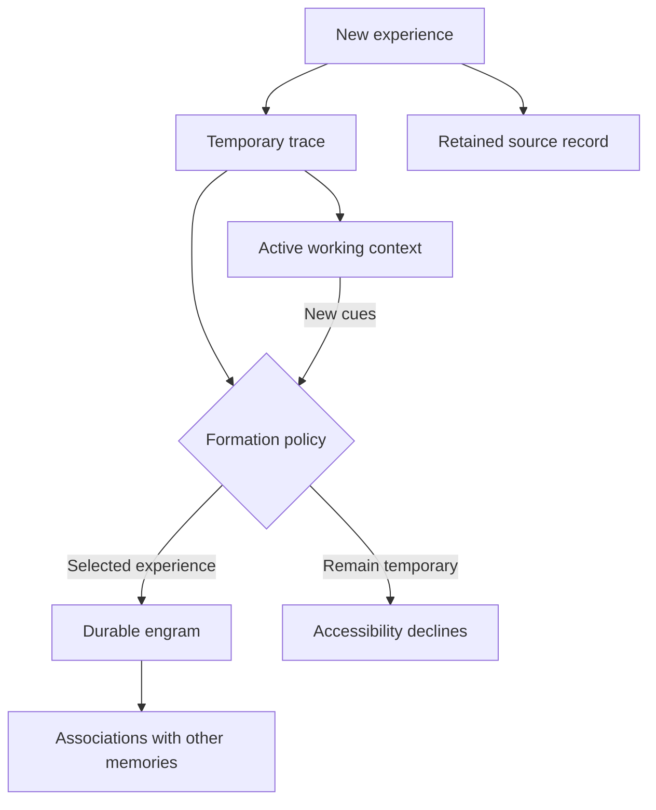
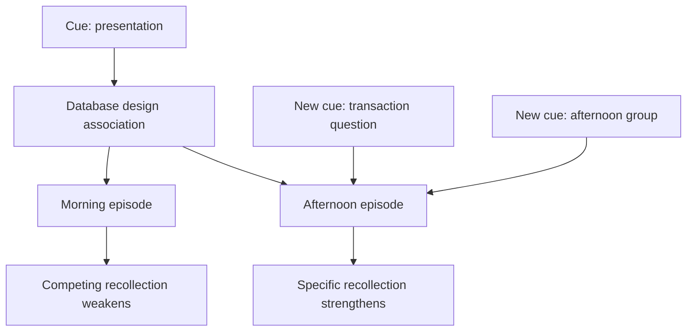
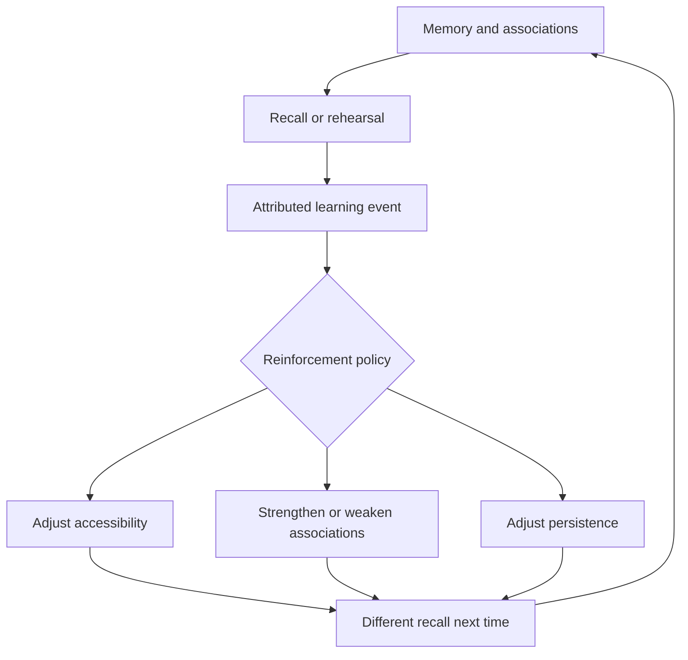
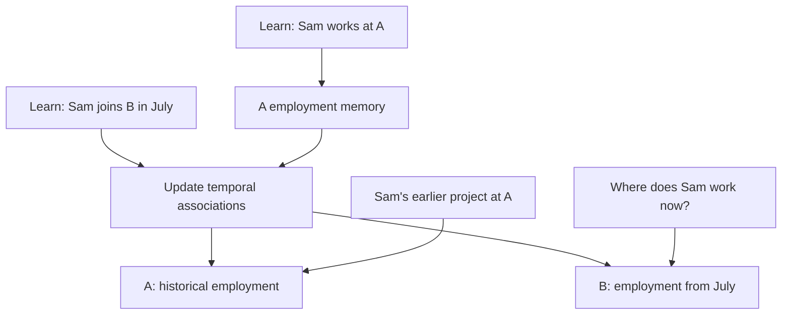
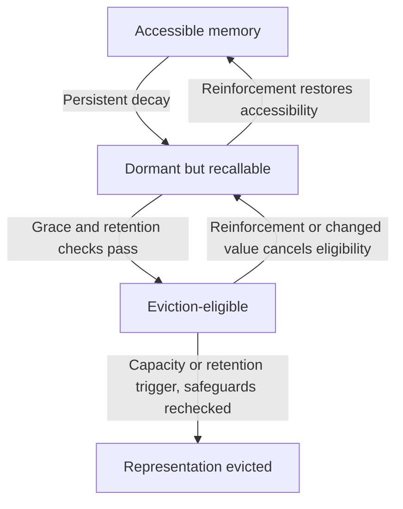
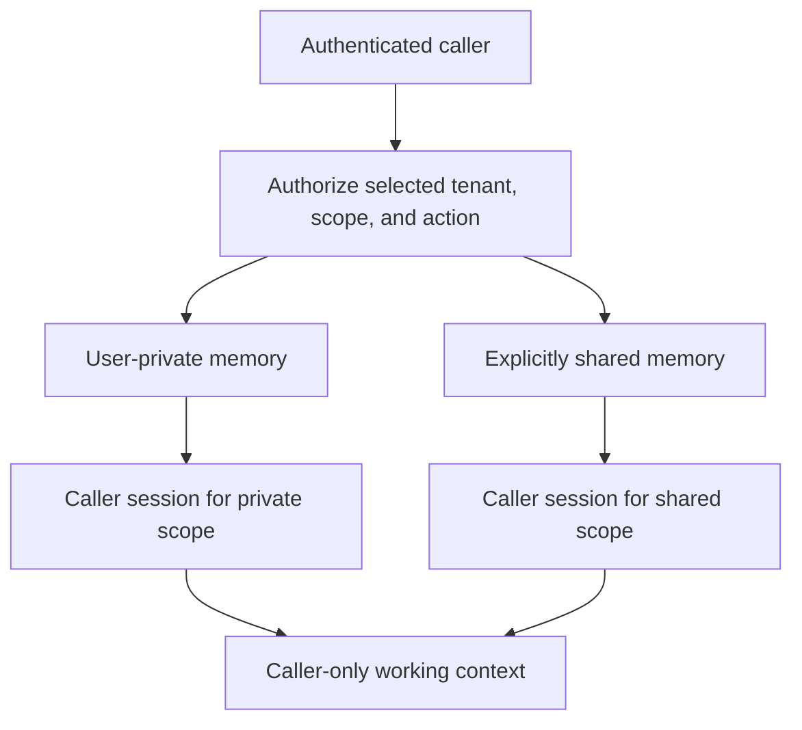
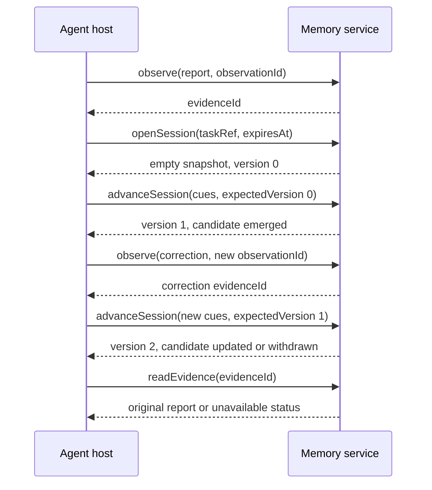
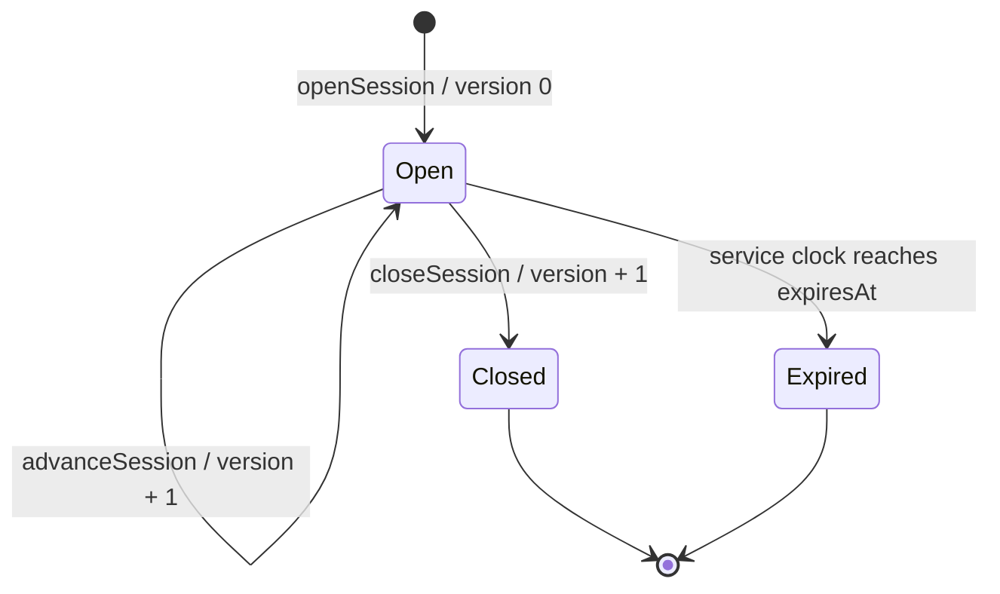

# Recall Delta Protocol

Version **0.1-draft.4** · 8 November 2026 · Proposed requirements

License: [CC BY 4.0](../LICENSE-CC-BY) for prose and illustrations; [Apache-2.0](../LICENSE-APACHE) for implementation code, pseudocode, and JSON examples. See [licensing scope](../LICENSE.md).

## 1. Definition and memory model

**Recall Delta is an evolving associative memory system: experiences form memories and connections; context activates relevant recollections; reinforcement and new experiences reshape what can be recalled over time.**

Recall Delta Protocol is the language-neutral behavioral and data contract between an **agent host** and a **memory service** supporting that model. The host supplies observations and task context. The engine decides how experiences form traces and durable memories, how associations develop, and which memories become accessible as the task evolves.

A **recall delta** is an ordered change to the host-visible set of recall candidates in one session. It can reflect a new cue, reinforcement, a revised interpretation, or a change in the remembered world. The protocol distinguishes changes in what comes to mind from changes to stored memory. Both are part of the intended system.

The core standardizes observable exchange behavior, not one cognitive architecture, embedding model, graph algorithm, database, or transport. HTTP, MCP, and language SDK bindings would be separate specifications. A stateful search wrapper can exercise the core exchange; the full memory model additionally needs formation, association, reinforcement, and evolution policies. Performance improvements over simpler baselines must be measured.

### 1.1 Human inspiration and the agent analogy

Human episodic memory can bind people, places, objects, and other event elements so that a partial cue helps recover related elements. [Horner and colleagues](https://www.nature.com/articles/ncomms8462) provide experimental evidence for this kind of pattern completion. Retrieval practice can also improve later retention, including without feedback in the experiments of [Roediger and Karpicke](https://pubmed.ncbi.nlm.nih.gov/16507066/). These motivate associative discovery and reinforcement in the software model.

Working memory and short-term memory overlap in human theories; they are not necessarily consecutive containers. [Cowan's theoretical account](https://pmc.ncbi.nlm.nih.gov/articles/PMC2657600/) discusses these distinctions. The agent's context window is an analogy for an active working surface, not a biological equivalent. Leaving that window need not remove a trace from the memory service, and durable encoding need not wait for the window to fill.

Human remembering is selective and only partly voluntary. Our engine models automatic selection using salience, novelty, recurrence, associations, and usefulness. Its short-lived traces and durable engrams are engineering concepts. A salient event may be admitted immediately; reinforcement is one route to persistence, not a requirement for every memory. We do not claim a complete model of human emotion, trauma, or neural memory. Context compaction and factual-confidence estimates support this design but do not define its purpose.

### 1.2 Memory formation

The default integration is **observe experiences and let memory form**. A host does not need to label every observation remember or forget. The engine's configured policies decide whether to keep a temporary trace, form a distinct engram, connect an experience to existing memory, reinforce a pathway, or allow accessibility to decline. Declared privacy and retention policies still constrain every decision.

*Figure 1. Automatic memory formation. Recent traces can participate in working context while a policy forms or updates durable memory. Source-record retention is separate from trace decay; a single salient experience can be selected without repetition.*

### 1.3 Associative recall as context accumulates

A memory is reachable through multiple cues: a person, place, topic, time, related episode, or learned procedure. The engine carries activation across a session and may propagate it through associations while competing memories inhibit one another. No recall, partial recall, and a contextually wrong candidate are representable outcomes.

*Figure 2. An illustrative association network, not a guaranteed ranking or measured human result. Shared cues initially reach competing episodes; more specific cues support the afternoon episode through additional pathways. A different cue could instead surface the morning episode. More information does not guarantee monotonically increasing recall.*

The central variables are activation, cue fit, association strength, and accessibility. A later cue can reactivate an old memory that was absent from the current context. Long-term memory remains durable when recalled into the working surface.

### 1.4 Reinforcement and decay

Reinforcement changes future memory behavior. Distinct repetitions, retrieval practice, successful use, and new related experiences may strengthen accessibility, stability, or selected associations under the engine's policy. Rejection, interference, disuse, and changed context may weaken or redirect them. These are separate effects; no universal strength score has to control all of them.

*Figure 3. Reinforcement affects future recall, with distinct effects on accessibility, association strength, and stability. Events must be deduplicated so a retry does not apply the same reinforcement twice. Private learning stays private under section 4.*

**Decay** is the gradual reduction of accessibility or pathway strength under a declared policy. Forgetting can be an outcome of decay; it is not the primary operation in this model. A memory can become difficult to find while its representation remains stored. Retrieval may reinforce caller-local accessibility or associations without supplying new factual evidence. Confirmation is not required for every accessibility update; factual-confidence metadata remains a separate, secondary concern.

### 1.5 Memory evolution and changing circumstances

The model distinguishes **recall evolution** (what comes to mind now) from **stored-memory evolution** (what was learned and how it relates to later experience). An update can correct an earlier interpretation, add context, form a new episode, or reflect a genuine change in the world. A memory that was appropriate earlier can become historical without becoming a mistake.

*Figure 4. Changing facts preserve useful history. Current and historical cues can activate different memories. The later observation does not erase the earlier experience or imply it was wrong when formed.*

Implementations representing changing facts MUST distinguish when information was recorded from the period it describes. They MUST preserve revisions while policy permits and distinguish a correction from a state change when that distinction is known. Unknown dates MUST remain unknown. They MUST NOT silently present a known historical state as current solely because it has stronger activation. Historical states remain eligible for contextually appropriate recall.

### 1.6 Decay, dormancy, and eviction

An engineered memory system needs bounded storage as well as recall and formation. **Decay makes a memory eligible for eviction; it does not itself delete the memory.** Low activation in one task says little about a memory's long-term value. The model therefore separates task-specific activation from persistent accessibility, stability, and retention value.

*Figure 5. Dormancy is reversible and dormant memories can still respond to strong cues. Eligibility requires sustained decay, a grace period without qualifying reinforcement, low retention value, and dependency/protection checks. Eviction is a separate capacity or retention decision; it is not evidence erasure.*

A rarely recalled historical event, a stable preference, or a unique useful procedure may remain valuable for a long time. Age, a job change, or absence from the current task MUST NOT alone make it disposable. Reinforcement can restore accessibility or restart the grace period before eviction. Section 12 defines the retention safeguards and storage accounting; no universal decay rate, grace period, or score threshold is prescribed.

The [worked memory-evolution example](../examples/memory-evolution.json), [decay and eviction cases](../examples/decay-eviction.json), and [conceptual TypeScript model](../docs/conceptual-typescript.md) map these processes to records and policy boundaries. This is the intended memory lifecycle; later sections define the core exchange and its limits.

## 2. Status and conformance language

MUST, MUST NOT, SHOULD, SHOULD NOT, and MAY express proposed obligations within this draft. They do not indicate adoption by a standards body. A future conformance claim needs a named protocol version, capabilities, tested scenarios, and an actual implementation.

The readable JSON examples use camelCase field names. All strings, numbers, objects, and arrays have their ordinary JSON meanings; IDs and cursor tokens are opaque strings. Numbers MUST be finite. Timestamps use RFC 3339 UTC strings. Object-member order has no meaning; array order has meaning where specified.

## 3. Scope and profiles

The **core** covers capability discovery, observation admission, evidence resolution, recall sessions, feedback recording, and the semantics of recall deltas. A read-only wrapper around another memory product is not core-conforming unless it provides these operations.

Optional profiles are deliberately outside the core:

| Profile | Possible responsibility |
| --- | --- |
| Memory lifecycle | Detailed formation/learning receipts, consolidation, merging, splitting, and semantic abstractions |
| Associative activation | Weighted edges, propagation, inhibition, task-activation decay |
| Stochastic recall | Controlled variability, random-source identity, reproducibility limits |
| Lifecycle management | Persistent-accessibility decay, dormancy, bounded retention, eviction, archival, erasure, completion reporting |
| Portable bundles | Export/import of canonical records with provenance and policy |
| Context assembly | Token budgets and model-specific context construction |

These profiles have no wire contracts yet. The automatic memory lifecycle is central to the reference-engine vision; these profiles standardize richer exchanges around it, rather than making the vision a context-window optimization. The core admission receipt does not claim that consolidation has completed. An engine MUST NOT advertise an optional profile as interoperable solely because it has a similarly named internal feature.

## 4. Actors, identity, and boundaries

- The **host** supplies observations and cues and consumes recalls.
- The **service** admits evidence, maintains memory, and advances sessions.
- The **principal** is the effective authenticated user for the memory operation. When a service acts on that user's behalf, the binding MUST preserve both the effective user and acting-service identity. A shared agent service credential alone MUST NOT grant access to every user's memory.
- A **tenant** is an organizational or application security boundary. Membership in a tenant does not grant access to every memory in that tenant.
- A **scope** is an authorized memory namespace within a tenant. Each operation is bound to exactly one scope. A service MUST authorize the principal for the requested action, scope, and referenced objects before reading, traversing, scoring, or mutating them.

IDs are unique within a tenant, scope, and object type. References cannot implicitly cross scopes or tenants. The service MUST enforce the same boundary for direct reads, graph traversal, caches, session restoration, error details, and optional exports. A single-user local service may implement one tenant and one private scope; multi-tenancy is not required.

An evidence source is not necessarily authoritative. Memory content MUST be treated as untrusted data, not elevated to system instructions or permission to act. A recall MUST NOT itself grant access, authorize an external action, or establish whether a tool call succeeded. The host owns verification against authoritative state.

### 4.1 Trusted caller context

Recall may be fallible; authorization MUST use deterministic policy checks and deny access when trusted context is missing or invalid. Bindings MUST derive the effective principal from authenticated identity and verify tenant membership and scope grants. A user-supplied userId, tenantId, agentId, role, or scope name is at most a requested target, never proof of authority. Observation content, cues, and model-generated tool arguments MUST NOT replace that context.

An agentId identifies the application/agent, and may be an additional policy restriction. A conversationId identifies a conversation. Neither establishes a user's identity or access rights. The person mentioned in a memory is its **subject**, which need not be its owner or an authorized reader.

The core has no mandatory authentication technology. An embedded binding can use a trusted local caller; a remote binding can verify credentials and delegated identity. Both must preserve the same access semantics. This approach follows [OWASP's guidance on authenticated tenant context and isolation](https://cheatsheetseries.owasp.org/cheatsheets/Multi_Tenant_Security_Cheat_Sheet.html).

### 4.2 Private and shared scopes

New observations MUST enter a user-private scope unless the caller explicitly targets a scope with an authorized shared-write policy. An unbound operation MUST fail; it MUST NOT fall back to a common or shared namespace. The following scope kinds describe the proposed visibility model:

| Scope kind | Eligible readers, subject to current policy | Typical use |
| --- | --- | --- |
| `user-private` | Owning user and services explicitly delegated to act for that user | Personal preferences and experiences across conversations |
| `conversation` | Explicitly authorized participants and delegated services | Shared conversation evidence and temporary traces |
| `group-shared` | Current authorized members of a team or project | Shared project experience |
| `tenant-shared` | Explicitly authorized tenant members | Approved organizational knowledge |

Scope metadata MUST identify the tenant, opaque scope ID, kind, and applicable owner or membership policy. Scope IDs do not encode authority; implementations MUST NOT infer grants from a naming convention. Read, observation admission, feedback, memory mutation, and sharing are distinct permissions. Being able to recall a shared memory does not grant permission to modify it.

The scope kinds are alternatives, not an inheritance chain. A user-private scope is not readable merely because the caller belongs to the same group, tenant, or agent application. Implementations may support only user-private scopes; they MUST reject unsupported kinds rather than silently broaden access. Administrative access, if any, must be an explicit policy grant rather than an implied consequence of a private-scope label.

*Figure 6. Private and shared recall use separate scoped sessions. The host may combine authorized outputs for the caller while retaining each result's scope and provenance. Unauthorized memories never enter recall.*

### 4.3 Session ownership and combining results

Each recall session MUST be bound to its creating principal, tenant, scope, and any agent restriction. This ownership covers its activation state, snapshot, deltas, feedback, and retry receipts. Shared access to underlying memories MUST NOT expose another user's session or private feedback. Session IDs are locators, not access tokens. Shared multi-user recall sessions are not defined by this core; even conversation-scope readers open separate caller-owned recall sessions.

A host that needs private and shared knowledge may open a separate session for each authorized scope. It MUST retain the full tenant/scope/session/candidate identity when combining results, because IDs can repeat across scopes. Combining outputs MUST NOT broaden their audience or create cross-scope graph edges. A working context containing private results remains restricted to the caller and services authorized for those results. A federated cross-scope activation algorithm is outside this draft.

### 4.4 Permission-preserving recall and learning

Authorization MUST restrict the eligible memories, evidence, and associations before retrieval results enter activation, ranking, traversal, or reconstruction. Fetching private candidates and asking the language model to suppress them is not an access-control mechanism. Candidate existence, source references, competing-memory details, and scores MUST NOT disclose unauthorized records. Activation and ranking for one caller MUST NOT incorporate another user's private state.

Automatically derived traces, summaries, engrams, embeddings, associations, and procedures MUST retain restrictions at least as strict as those of their sources. Within a scope, a derivation's eligible readers cannot exceed the intersection permitted by its source policies. Dependencies must remain attributable so later revocation or erasure can invalidate affected derivatives. Removing names or using more general wording does not authorize sharing.

Private feedback and recall activity MUST remain in caller-specific learning state by default, even when they concern shared memories. They MUST NOT automatically modify another user's activation, shared association weights, shared factual confidence, or other cross-user learned state. Mutating shared learned state requires a separately authorized, explicitly shared input and an applicable learning policy. Background consolidation and queued work MUST carry the same caller/scope restrictions and revalidate access before publishing results.

Promotion into a broader scope requires an explicit authorized sharing workflow: current access to the source, permission to disclose it, permission to write the destination, and a recorded decision/lineage. This core does not define a sharing operation or permit cross-scope evidence references. A future sharing profile must specify how protected source lineage and destination records are represented without exposing restricted evidence IDs or content. No implicit promotion is allowed while that contract is absent.

### 4.5 Caches, replay, and revocation

Cache entries, retry receipts, and session checkpoints MUST distinguish tenant, scope, principal, and any relevant agent restriction; session-specific entries also include session identity. Shared caches may be used only for data with an explicitly shared audience and must still enforce current access. A cached grant or previously successful read MUST NOT override revocation. Implementations need an authorization-version check, invalidation mechanism, or equivalent protection when serving results and committing work.

These are protocol obligations, not a guarantee that a particular implementation cannot leak. The [isolation scenarios](conformance.md) must be exercised across storage, search, graph edges, jobs, history, and host context assembly. Infrastructure/operator access and the host's handling of already delivered data need their own controls.

## 5. Records

### 5.1 Evidence and observations

An observation supplies `observationId`, `kind`, `content`, `observedAt`, and a `source` containing `type` and `id`. Kind is `message`, `tool-result`, `document`, `event`, or `state-change`. Optional `source.uri` is a locator, not an instruction to fetch arbitrary content. The content is any JSON value. The service records its own `recordedAt` timestamp and returns an `evidenceId`.

`observationId` MUST be a caller-stable deduplication key within the scope. Reusing it with identical observation fields returns the original evidence ID; different fields return `id_conflict`. Object-member ordering does not make an observation different. Array order does.

Evidence MUST preserve the admitted content and provenance while retained. Corrections are new observations referencing the old evidence; they MUST NOT silently rewrite it. Evidence records attest to what was reported, not the truth of that report. Policy-driven redaction or deletion may make content unavailable; section 12 governs how that is reported.

The reference engine automatically evaluates observations for trace formation, associations, and durable encoding under its policies. The host need not choose each memory manually. The core admission receipt confirms recorded evidence, not completion of every learning effect; a richer lifecycle receipt is deferred to an optional profile. No particular gate, learning algorithm, or durable engram for every observation is required by the core exchange.

### 5.2 Recall candidates

A candidate is one surfaced interpretation in a session:

| Field | Meaning |
| --- | --- |
| `candidateId` | Stable identity within the session; independent of a storage row ID |
| `memoryRefs` | Array of opaque trace/engram references, possibly empty |
| `content` | The recalled interpretation as JSON |
| `activation` | Engine-local, session-specific activation estimate in [0, 1]; distinct from persistent accessibility and retention value |
| `relevance` | Engine-local fit to the current cues in [0, 1], or null if unknown |
| `validTime` (optional) | `{from, until}` for a temporal claim, or null when unknown; UTC bounds use an inclusive start and exclusive end. A null from is an unknown start; a null until means no end has been recorded. Omission does not assert current validity. |
| `factualConfidence` | Engine-local credibility estimate in [0, 1], or null if unknown |
| `uncertainty` | Object with `ambiguity`, `contradiction`, `sourceDoubt`, and `missingContext`, each [0, 1] or null |
| `evidenceRefs` | Nonempty array of `{evidenceId, role}`, where role is `supports`, `contradicts`, or `context` |
| `verification` | `required` or `unspecified`; `unspecified` never means verified |

At least one evidence reference MUST have role `supports` or `context`; the record MUST not imply that all cited evidence supports the content. Whether a record actually entails a claim is a semantic evaluation question, not guaranteed by the presence of an ID.

Higher numerical values mean more of the named property. Scores are estimates, not calibrated probabilities unless a separately described calibration supports that interpretation. Scores MUST NOT be compared across engines as if they had a common statistical scale. Unknown estimates MUST be null rather than fabricated zeroes.

Activation and relevance concern finding memories. Factual confidence, uncertainty, and verification are supplementary metadata; the central objective is memory discovery and evolution. These estimates MUST remain distinct from activation. If a historical claim has a known validity interval, its candidate MUST include validTime or an explicit temporal qualification in content. Recall engines may interpret temporal cues; a standardized temporal-query binding is not yet defined.

Capability discovery identifies the scoring method/configuration through an opaque `engineProfile` string. It is fixed for a session; a changed engine/profile requires a new session. It is not sufficient by itself for deterministic replay.

`candidateId` MUST remain stable when the same interpretation's content, scores, or evidence are revised. A different incident or proposition uses a different ID. A withdrawn candidate can re-emerge with the same ID if it is the same interpretation. This mapping is engine-owned and SHOULD be explainable; memory merge/split behavior is a future profile.

## 6. Core operations

The operation names describe logical calls, not URL paths or method signatures. Bindings supply authentication and framing. All mutating calls carry a `requestId`, stable across retries, in addition to the fields below.

*Figure 7. Ingestion and advancement are separate. A correction adds evidence; an explicit advance communicates its effect on recall. Successful responses here represent committed results.*

| Operation | Input beyond scope and requestId | Successful result and effect |
| --- | --- | --- |
| `describe` (read) | None | Protocol versions, engineProfile, supportedScopeKinds, limits, session durability, replay retention, supported optional features |
| `observe` | Observation | Evidence ID; admits an experience for automatic memory processing without implicitly advancing sessions. Receipt confirms evidence admission, not completed consolidation. |
| `readEvidence` (read) | Evidence ID | Original evidence/provenance or explicit unavailable status |
| `openSession` | `protocolVersion`, `taskRef`, `expiresAt` | New session ID, version 0, `open` state, engineProfile, empty candidate set |
| `advanceSession` | Session ID, `expectedVersion`, complete replacement `cues` array, newly selected `evidenceIds` array | Atomically committed next session version and its delta batch |
| `readSession` (read) | Session ID | Complete current snapshot with session version and status |
| `readDeltas` (read) | Session ID, `afterVersion` | Contiguous committed batches through a stated `throughVersion`, or `resync_required` |
| `recordFeedback` | Session ID, candidate ID, `atVersion`, kind, evidence IDs, optional explanation | Feedback ID, `recorded` receipt; does not imply truth was established or learning completed |
| `closeSession` | Session ID, expectedVersion | Next version with state `closed`; no further advances |

`taskRef` is an opaque host reference, not authoritative workflow state. `cues` is an ordered array of JSON cue values; it replaces the previous cue set to avoid unspecified accumulation. `evidenceIds` is the selected contextual evidence for this advance; it does not prevent retrieval from other authorized memory in the same scope. Observation ingestion and session advancement are separate so the same event cannot advance a session twice through two APIs.

The requested protocolVersion must be one offered by describe. A session is bound to that version for its lifetime; bindings must retain that association when reading or restoring the session. expiresAt must be in the future and within the advertised maximum lifetime, otherwise openSession returns `invalid_request` or `limit_exceeded` respectively.

Observation admission is atomic: acknowledgement means the evidence is recorded according to the advertised durability. Session advances atomically commit the snapshot, version, delta batch, and retry receipt. Services whose stores lack native transactions MUST implement equivalent visibility/recovery guarantees or reject the operation. They cannot silently offer weaker semantics under the same core contract.

`describe` MUST state supportedScopeKinds, maximum observation size, cue size, active candidates, session lifetime, retry-receipt lifetime, delta-history lifetime, and whether acknowledged state survives a process restart. Supported kinds do not enumerate or grant access to any scope. Bounds are negotiated before session creation. Core permits explicitly advertised volatile sessions; restoration of acknowledged sessions is not universally promised.

## 7. Session state and concurrency

The lifecycle is `open → closed` or `open → expired`. Expiry is evaluated against the service's clock using the agreed `expiresAt`. Closing is explicit; expiration takes effect at the deadline even if no client is connected. Read operations may return the terminal status while retained. Candidate payloads in a terminal snapshot are historical and MUST NOT be presented as current recall. When the session is no longer retained, calls return `session_unavailable` and the host must start a new session.

*Figure 8. Empty advances still move the version forward. Closed and expired sessions cannot be advanced; a new task session starts with a new identity.*

Versions are nonnegative JSON safe integers, starting at 0. Each accepted advance or close increments the version by exactly one, including an advance with no candidate changes. The service serializes writes per session. A mismatched `expectedVersion` returns `version_conflict` without applying the attempted write. The host must read current state before deciding whether to issue a new request.

Before incrementing beyond 9007199254740991, the service MUST close/reject further advancement and require a new session; numeric wraparound is forbidden.

Feedback records are separate from session versions. They influence the session only on a later explicit advance. Background learning may change the memory store, but MUST NOT silently rewrite an already committed session snapshot or its historical delta batches. A future live-update profile may provide explicit autonomous advances.

## 8. Delta batches and application

A batch contains `sessionId`, `engineProfile`, `fromVersion`, `toVersion`, `status` (`open` or `closed`), and ordered `changes`. `toVersion` is exactly `fromVersion + 1`. The proposed change vocabulary is deliberately small:

| Type | Payload | Meaning |
| --- | --- | --- |
| `candidate.emerged` | `candidateId`, full `current`, nonempty `reasonCodes` | Candidate absent from the previous surfaced set becomes present |
| `candidate.updated` | `candidateId`, full `current`, nonempty `reasonCodes` | Present candidate changes content, evidence, or any score |
| `candidate.withdrawn` | `candidateId`, nonempty `reasonCodes`; no current payload | Present candidate is removed from the surfaced set |

`current.candidateId` MUST equal the change's candidateId. A batch MUST contain at most one change per candidate. An emerged candidate must be absent before the batch; an updated/withdrawn candidate must be present. Clients MUST reject an invalid transition without partially applying the batch and obtain a fresh snapshot.

Changes MUST describe the complete difference between the old and new host-visible sets. Every changed field is material at the protocol boundary. Engines MAY use rounding, thresholds, or hysteresis before committing their public state, but MUST NOT change a public snapshot without the corresponding delta. Unchanged advances have `changes: []`; silence is distinct from transport failure.

Standard reason codes are `cue_match`, `cue_changed`, `evidence_changed`, `feedback_applied`, `memory_formed`, `association_changed`, `reinforced`, `memory_revised`, `state_changed`, `temporal_context`, `memory_decayed`, `memory_evicted`, `policy_removed`, `budget_evicted`, and `source_unavailable`. Additional codes use `x-` prefixes and MUST NOT change transition semantics. Reasons distinguish new cues from reinforcement, revision, changed world state, and retention effects without requiring every internal learning event to emit a public recall. `memory_evicted` concerns a stored representation; `budget_evicted` concerns the surfaced candidate budget. Neither means source evidence was erased. Strengthening and weakening refer to named scores in an update. Suppression is an internal policy; its public removal is a withdrawal.

Closing produces an empty changes batch with status `closed`, preserving its last set as historical state. Expiry need not produce a retained batch; a read or an expired-operation error tells the host to discard the current set.

## 9. Delivery, retries, and resynchronization

The service MUST retain each mutating request's logical payload and committed outcome for the advertised retry lifetime. A retry with the same tenant, principal, scope, operation, and requestId returns that outcome without a second write, subject to any agent/delegation restriction. Different payload under the same key returns `id_conflict`. These retry checks precede optimistic-version checks, so a successful advance can be retried after its original expectedVersion becomes stale. Authorization is rechecked on every retry; revocation overrides receipt replay.

After the advertised receipt lifetime, the host MUST stop retrying an uncertain mutation as if its key were still protected. It uses `readSession` and retained history to reconcile, or opens a new session. The service cannot infer an old outcome from a missing receipt and is not required to retain all request IDs forever. This draft does not promise exactly-once delivery forever. `observe` additionally retains observation-ID deduplication while the associated evidence record is retained.

Clients apply only batches whose `fromVersion` equals their current version. Redelivered older batches are ignored; gaps, conflicting content for the same version, or unavailable history require `readSession`. A successful `readDeltas` result MUST be contiguous from the requested afterVersion through its throughVersion. It MAY be a bounded prefix; the host continues from throughVersion. An up-to-date result has no batches and throughVersion equal to afterVersion. History cannot be silently skipped.

A snapshot atomically supplies `sessionId`, `engineProfile`, `version`, `status` (`open`, `closed`, or `expired`), and all current candidates. Its status and payload represent the same observation of service state. The binding MUST retain and verify the session's caller/tenant/scope association for snapshots and batches, including restoration; those IDs are not additional authority. The host replaces its local set in full. It must clear expired/closed recalls from active use and must discard cached recalls when access is revoked, even if previously delivered history contains them.

## 10. Reinforcement, feedback, and evolution

An engine's automatic policy may use the following distinct events. These describe behavior, not additional mandatory transport operations:

| Event | Possible effect on future memory |
| --- | --- |
| Salient or novel experience | Form a durable memory after one encounter or initialize accessible associations |
| Distinct recurrence or rehearsal | Strengthen accessibility, selected associations, or stability |
| Accepted retrieval | Refresh caller-local accessibility or reinforce selected pathways |
| Useful outcome | Strengthen a useful procedure or cue pathway |
| New contextual detail | Link, separate, or revise memories and their associations |
| Observed state change | Form a new state, update temporal associations, preserve the earlier state as history |
| Correction or rejection | Revise an interpretation, weaken a distracting pathway, or preserve competing accounts |

Policies MUST distinguish distinct learning events from replays of the same event. Retried observation, feedback, and advance requests MUST NOT duplicate learning effects within the declared replay window in section 9. A reference-engine profile must declare its internal learning-event deduplication lifetime; an absent old receipt does not establish an old outcome. Autonomous consolidation must retain attributable inputs and the scope restrictions in section 4. Its effects become visible to an existing recall session only on a later explicit advance.

Feedback kinds are `confirmed`, `rejected`, `corrected`, `useful`, and `independently_supported`. The caller identifies the candidate and a committed version where that candidate was present. If the historical candidate/version is not retained, the service returns `feedback_target_unavailable`; it MUST NOT attach feedback to a different current interpretation by guesswork.

Feedback MUST preserve who supplied it, its evidence references, and its stated kind. It is a report, not an automatically trusted fact. `corrected`, `confirmed`, and `independently_supported` require nonempty evidence IDs. Host/user feedback itself can first be ingested as an observation. A correction's evidence carries the corrected claim; a future encoding profile decides whether to revise, split, or supersede the underlying memory.

Feedback is private to its caller-owned session unless a separate authorized workflow explicitly submits it as shared input. Evidence references remain restricted to the operation's scope. A private correction cannot be attached to a shared record through a cross-scope evidence reference; until a sharing profile exists, the host must keep that interpretation in its private context. A feedback receipt never implies permission to mutate shared memory.

Recall and rehearsal MAY reinforce accessibility or caller-local associations under the configured policy. They MUST NOT count as independent factual support, and any effect on credibility must have a separately attributable evidential basis. A policy may apply cooldowns to repeated unchanged cues. `useful` reports task utility. Source independence cannot be guaranteed merely because two evidence IDs differ. These supplementary evidence rules do not prohibit the reinforcement of recall pathways.

## 11. Errors

Failures contain a stable `code`, human-readable `message`, and `retryable` boolean. They MUST NOT expose objects outside the caller's authorized scope. Authentication/binding errors remain binding-defined.

| Code | Meaning / host action |
| --- | --- |
| `invalid_request` | Shape/range/transition invalid; correct it before retrying |
| `unsupported_version` / `unsupported_feature` | Negotiate another supported contract |
| `scope_unavailable` | Scope unknown or inaccessible, or the action is not authorized; no existence disclosure |
| `id_conflict` | Key reused with different payload; investigate caller state |
| `version_conflict` | No write applied; read current session |
| `resync_required` | Delta history cannot satisfy the requested contiguous range; read snapshot |
| `session_closed` / `session_expired` | Stop advancing and remove active recalls |
| `session_unavailable` | Unknown, unauthorized, or no longer retained; do not infer existence |
| `evidence_unavailable` | Evidence absent, inaccessible, or deleted; content MUST NOT be reconstructed as if original |
| `feedback_target_unavailable` | Historical target cannot be resolved |
| `limit_exceeded` | Advertised request or storage bound exceeded; reduce the request or resolve the stated capacity limit; a new session does not bypass a scope's storage limit |
| `temporarily_unavailable` | No committed result returned; retry same requestId within receipt lifetime or reconcile |

A transport timeout or lost response has unknown outcome. It is not evidence that a mutation failed. An engine MUST NOT acknowledge a partially committed operation as success.

## 12. Retention, provenance availability, and privacy

### 12.1 Distinct lifecycle decisions

Immutability means no silent alteration while retained; it does not prohibit authorized erasure. The optional lifecycle profile MUST distinguish these effects. The core does not claim a universal deletion API or completion SLA.

| Decision | Meaning |
| --- | --- |
| Activation decay | A memory becomes less active in one caller's task; its durable representation remains |
| Persistent-accessibility decay | Durable accessibility/pathway strength decreases under engine policy |
| Dormancy | A retained memory is less readily accessible but can still respond to relevant cues |
| Consolidation or compression | Representations are combined or reduced while preserving declared meaning, history, lineage, and source restrictions |
| Archival | A retained representation moves to another storage tier; it still occupies storage |
| Eviction | A chosen representation is removed from the managed memory store, with references reconciled; source evidence has a separate policy |
| Erasure | Content and affected derivatives become unavailable under an explicit data-removal policy, independent of decay or capacity pressure |

### 12.2 When decay permits eviction

An engine implementing decay-based eviction MUST declare its evaluation time basis, decay/checkpoint rules, dormancy threshold, grace period, qualifying reinforcement events, retention-value criteria, protections, dependency rules, and eviction unit. No numeric defaults are mandated. A background sweep, admission path, or explicit maintenance cycle may evaluate these rules; absence of a recall call MUST NOT prevent an advertised retention rule from being enforced.

Decay-based eligibility requires **all** of the following at the decision time:

1. Persistent accessibility has remained below the declared dormancy threshold for the grace period. Low session activation, age, or last-access time alone is insufficient. If continuous dormancy cannot be established, the engine MUST conservatively establish a new start rather than invent elapsed grace.
2. No qualifying reinforcement has occurred within that period. Such reinforcement MUST cancel prior eligibility and restart grace or restore accessible status as appropriate. A retried event MUST NOT refresh the clock again. Mere index scans or maintenance reads are not reinforcement.
3. Assessed retention value is at or below the configured eviction cutoff. Criteria SHOULD consider use across tasks, stability, uniqueness, historical usefulness, redundancy, and the value of dependencies. Unknown value MUST NOT be treated as zero. Factual confidence is not a substitute for retention value.
4. No applicable retention protection blocks removal, and dependencies can be safely reconciled. A pin, unique historical record, supporting memory, or required recovery record must be evaluated under the declared policy; supersession alone is not permission to remove it.

Eligibility is provisional, not an irreversible queue. An engine MUST recheck current state, reinforcement, protections, source policy, and dependencies before committing eviction. Concurrent reinforcement or a revised value assessment can invalidate a stale decision. Private personalization can reset a caller's overlay without changing a shared base memory's retention state; shared maintenance requires its own authority under section 4.

### 12.3 When eligible memory is evicted

The engine MAY evict eligible representations when a declared capacity budget is under pressure, or when an explicit retention rule calls for removal. It SHOULD select low marginal retention value relative to the bytes actually reclaimable, while honoring protections and dependencies. Zero-reclaim removals do not solve storage pressure. Explicit erasure or a separately declared mandatory expiry can bypass decay eligibility; they MUST NOT be reported as decay-based eviction.

A bounded-retention implementation MUST declare its accounting boundary, hard limit, maintenance target/headroom, and behavior when the target cannot be reached. Accounting MUST cover all service-managed retained tiers within that boundary: traces, engrams and versions, associations, private overlays, evidence/artifacts, indexes/caches, snapshots/history, retry/learning receipts, and eviction markers. Moving data to an archive does not reclaim total retained bytes. External stores and already delivered host copies MUST be named as outside that boundary rather than silently counted as reclaimed. Shared bytes MUST NOT be counted as reclaimed while another retained reference keeps them allocated.

Eviction MUST remove or reconcile incident graph edges, indexes, caches, and dependent interpretations before those paths are used again. The engine MUST account for any representation still retained in session history or receipts; removing an engram does not by itself erase those copies. Required retry/durability promises continue to apply. Maintenance work and its markers also consume capacity; implementations need enough headroom to commit or recover cleanup.

If no safe eligible set can reclaim enough space, the engine MUST report capacity exhaustion or enforce declared backpressure/admission limits. It MAY first consolidate safely or reduce new admission. It MUST NOT silently override protections, discard required receipts, or claim an archive solved a total-storage limit. An observation already acknowledged as retained cannot be silently lost; its processing or retention outcome must follow the advertised contract. A core call rejected before commit for an advertised storage limit uses `limit_exceeded`; lifecycle maintenance outcomes remain profile-defined.

Eviction may leave enough retained evidence to form a memory again later. The engine MUST declare re-encoding conditions, such as a genuinely new experience, a new relevant cue, or a bounded reconsideration interval. Routine background processing MUST NOT immediately recreate every evicted representation from unchanged evidence. Any scoped eviction marker used to prevent that loop has a declared lifetime, contains only necessary metadata, remains subject to privacy policy, and counts toward the budget.

Maintenance MUST NOT silently rewrite an existing session's committed public set. A subsequent explicit advance communicates any affected update or withdrawal using section 8; evicting one supporting engram need not withdraw a candidate reconstructable from other authorized retained memories. Ordinary capacity eviction does not retroactively revoke authorized historical snapshots. Erasure and access revocation impose the stronger restrictions below.

### 12.4 Erasure and access revocation

Regardless of profile, a service MUST enforce its declared authorization and retention policy. `readEvidence` MUST report unavailability honestly. Later advances MUST not return erased content or recover it from derived indexes; they must revise or withdraw affected candidates. Revoked objects MUST not be served from retry receipts or historical snapshots. Implementations must evaluate dependent memories, caches, and queued work; inability to meet policy cannot be hidden behind append-only storage.

The same restrictions apply to derived learning state and exports. A revoked source may require invalidating an interpretation or learned association even if its text no longer quotes the source. Services MUST deny affected output until its authorization can be established, rather than reconstructing it from stale activation, caches, or model state.

Already delivered host copies cannot be remotely erased by this protocol. A host is responsible for its own retention and reauthorization. Provenance references, graph topology, embeddings, and confidence metadata may themselves be sensitive; removing plaintext does not establish privacy.

## 13. What interoperability means

Two engines can conform while returning different memories and scores. Core interoperability means a host understands the same identities, field meanings, state transitions, error/retry semantics, and evidence boundaries. It does not mean equal ranking, equal factual accuracy, or identical reconstructed content.

Portable bundle syntax is deferred. Even a future bundle preserving records cannot guarantee behavior across different encoders, embeddings, scoring rules, seeds, clocks, thresholds, or engine versions. Exact replay requires pinned dependencies and deterministic execution beyond this contract.

## 14. Acceptance before implementation claims

Review the [conformance scenarios](conformance.md) and [open design questions](../docs/design-questions.md). No executable core conformance suite exists yet. The conceptual TypeScript reducer demonstrates a subset of session delivery; it is not a conforming memory service.

The next useful experiment is two independent small engines consumed by one host, including a stateless retrieval-plus-diff baseline. Only then should transport bindings, storage bundles, and SDK packages be stabilized.
