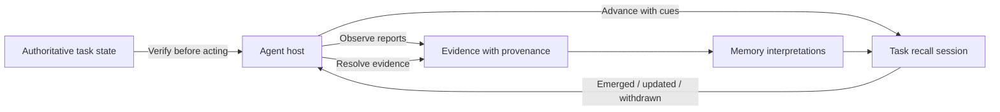
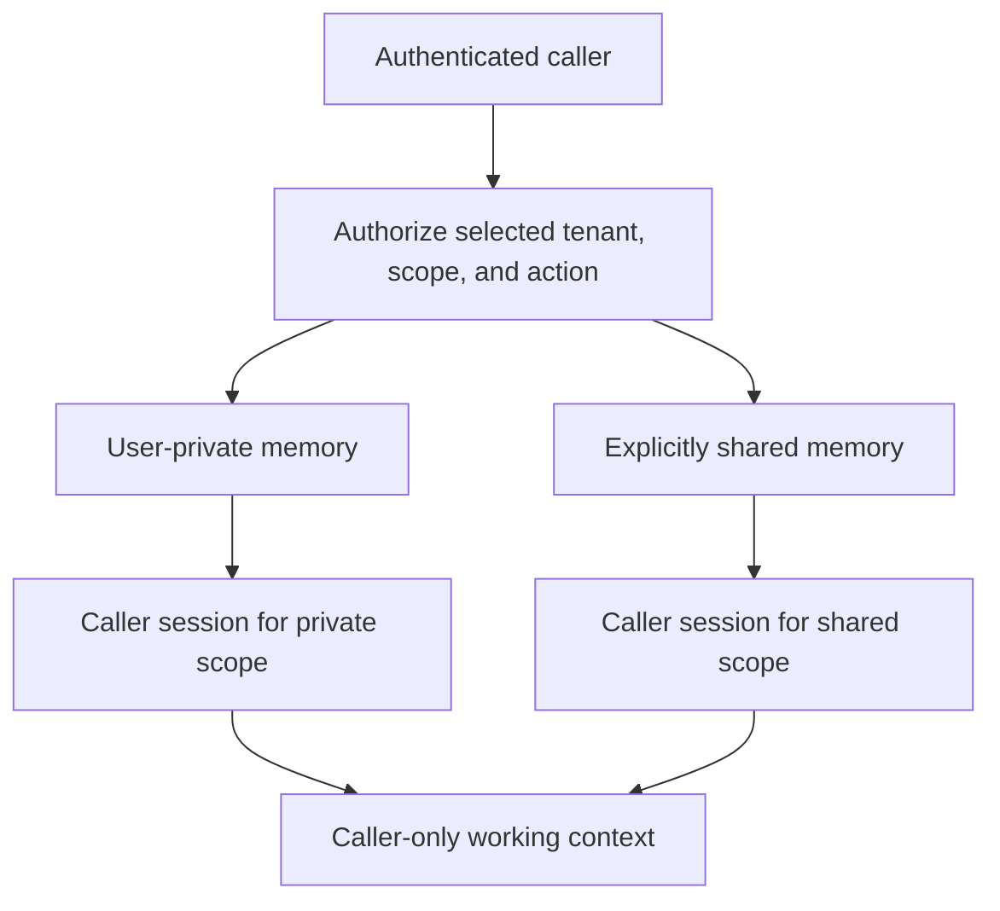
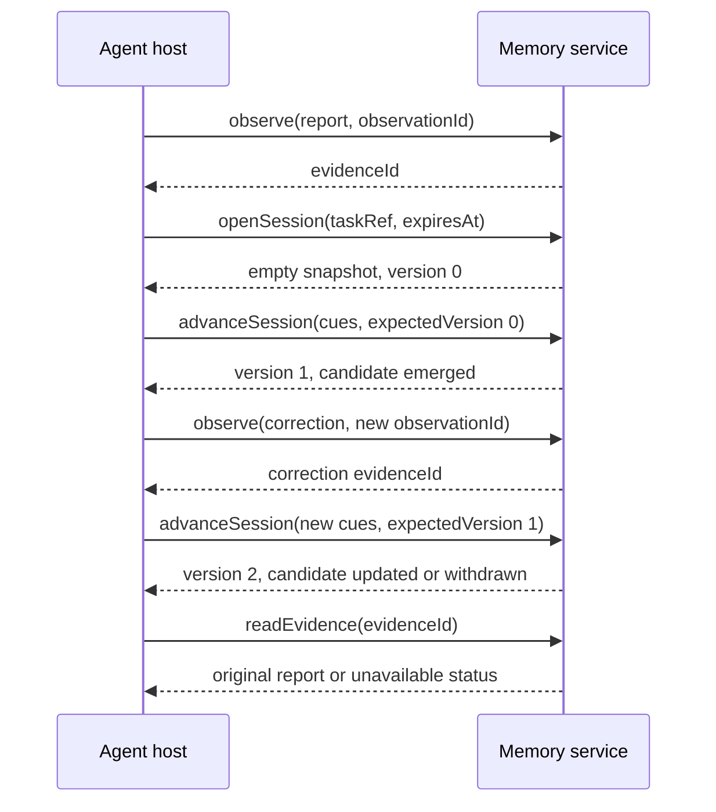
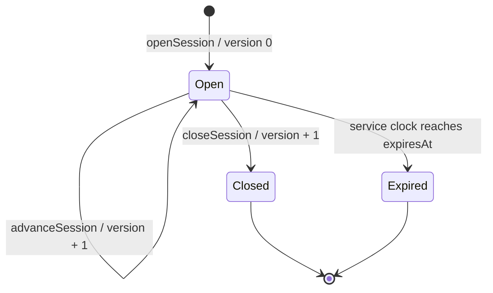

# Recall Delta Protocol

Version **0.1-draft.2** · 8 November 2026 · Proposed requirements

## 1. Definition

Recall Delta Protocol is a language-neutral behavioral and data contract between an **agent host** and a **memory service**. It describes how observations become available to memory, how a task maintains a session of surfaced recollections, and how changes to those recollections are communicated with provenance and uncertainty.

A **recall delta** is an ordered change to the host-visible set of recall candidates in one session. It is a change in recollection, not a claim that the underlying world changed. A candidate may become more relevant without becoming more credible; an earlier interpretation may be corrected without rewriting its source evidence.

The core standardizes observable behavior. It does not prescribe a cognitive architecture, embeddings, graphs, learning rules, a database, or a transport. HTTP, MCP, and language SDK bindings would be separate specifications. A stateful search wrapper can implement this contract; any advantage over that baseline must be measured.

### Design intent

The proposal is motivated by human-inspired remembering: an experience leaves a temporary trace, useful experiences may consolidate into durable memories, and partial cues can reactivate them during a task. Recollection can be absent, ambiguous, or initially wrong. As the conversation supplies new cues or corrections, the active recollection should be able to strengthen, weaken, change, or disappear while its factual credibility remains separately represented.

These behaviors are part of the intended memory system, not merely an optimization for context windows. Recall Delta is meant to be useful as an embedded library, a service, or an engine over different stores, independently of Skein and other frameworks. Context reconstruction and compaction are downstream possibilities.

The protocol gives that vision a common observable contract. The conceptual TypeScript section explores persistent activation and trace-to-engram formation. No particular biological mechanism, intentional random error, or universal improvement on every new cue is required: new evidence can legitimately increase uncertainty. The hypothesis to test is recovery and better discrimination as useful context accumulates.

*Figure 1. Evidence, memory interpretations, and task recall are separate. Recall changes guide the host's attention; the host still verifies operational facts against authoritative state.*

## 2. Status and conformance language

MUST, MUST NOT, SHOULD, SHOULD NOT, and MAY express proposed obligations within this draft. They do not indicate adoption by a standards body. A future conformance claim needs a named protocol version, capabilities, tested scenarios, and an actual implementation.

The readable JSON examples use camelCase field names. All strings, numbers, objects, and arrays have their ordinary JSON meanings; IDs and cursor tokens are opaque strings. Numbers MUST be finite. Timestamps use RFC 3339 UTC strings. Object-member order has no meaning; array order has meaning where specified.

## 3. Scope and profiles

The **core** covers capability discovery, observation admission, evidence resolution, recall sessions, feedback recording, and the semantics of recall deltas. A read-only wrapper around another memory product is not core-conforming unless it provides these operations.

Optional profiles are deliberately outside the core:

| Profile | Possible responsibility |
| --- | --- |
| Consolidation | Trace admission, merging, splitting, abstractions, durable engrams |
| Associative activation | Weighted edges, propagation, inhibition, decay |
| Stochastic recall | Controlled variability, random-source identity, reproducibility limits |
| Lifecycle management | Suppression, archival, deletion, retention completion reporting |
| Portable bundles | Export/import of canonical records with provenance and policy |
| Context assembly | Token budgets and model-specific context construction |

These profiles have no wire contracts yet. An engine MUST NOT advertise one as interoperable solely because it has a similarly named internal feature.

## 4. Actors, identity, and boundaries

- The **host** supplies observations and cues and consumes recalls.
- The **service** admits evidence, maintains memory, and advances sessions.
- The **principal** is the effective authenticated user for the memory operation. When a service acts on that user's behalf, the binding MUST preserve both the effective user and acting-service identity. A shared agent service credential alone MUST NOT grant access to every user's memory.
- A **tenant** is an organizational or application security boundary. Membership in a tenant does not grant access to every memory in that tenant.
- A **scope** is an authorized memory namespace within a tenant. Each operation is bound to exactly one scope. A service MUST authorize the principal for the requested action, scope, and referenced objects before reading, traversing, scoring, or mutating them.

IDs are unique within a tenant, scope, and object type. References cannot implicitly cross scopes or tenants. The service MUST enforce the same boundary for direct reads, graph traversal, caches, session restoration, error details, and optional exports. A single-user local service may implement one tenant and one private scope; multi-tenancy is not required.

An evidence source is not necessarily authoritative. Memory content MUST be treated as untrusted data, not elevated to system instructions or permission to act. A recall MUST NOT itself grant access, authorize an external action, or establish whether a tool call succeeded. The host owns verification against authoritative state.

### 4.1 Trusted caller context

Recall may be fallible; authorization MUST use deterministic policy checks and deny access when trusted context is missing or invalid. Bindings MUST derive the effective principal from authenticated identity and verify tenant membership and scope grants. A user-supplied userId, tenantId, agentId, role, or scope name is at most a requested target, never proof of authority. Observation content, cues, and model-generated tool arguments MUST NOT replace that context.

An agentId identifies the application/agent, and may be an additional policy restriction. A conversationId identifies a conversation. Neither establishes a user's identity or access rights. The person mentioned in a memory is its **subject**, which need not be its owner or an authorized reader.

The core has no mandatory authentication technology. An embedded binding can use a trusted local caller; a remote binding can verify credentials and delegated identity. Both must preserve the same access semantics. This approach follows [OWASP's guidance on authenticated tenant context and isolation](https://cheatsheetseries.owasp.org/cheatsheets/Multi_Tenant_Security_Cheat_Sheet.html).

### 4.2 Private and shared scopes

New observations MUST enter a user-private scope unless the caller explicitly targets a scope with an authorized shared-write policy. An unbound operation MUST fail; it MUST NOT fall back to a common or shared namespace. The following scope kinds describe the proposed visibility model:

| Scope kind | Eligible readers, subject to current policy | Typical use |
| --- | --- | --- |
| `user-private` | Owning user and services explicitly delegated to act for that user | Personal preferences and experiences across conversations |
| `conversation` | Explicitly authorized participants and delegated services | Shared conversation evidence and temporary traces |
| `group-shared` | Current authorized members of a team or project | Shared project experience |
| `tenant-shared` | Explicitly authorized tenant members | Approved organizational knowledge |

Scope metadata MUST identify the tenant, opaque scope ID, kind, and applicable owner or membership policy. Scope IDs do not encode authority; implementations MUST NOT infer grants from a naming convention. Read, observation admission, feedback, memory mutation, and sharing are distinct permissions. Being able to recall a shared memory does not grant permission to modify it.

The scope kinds are alternatives, not an inheritance chain. A user-private scope is not readable merely because the caller belongs to the same group, tenant, or agent application. Implementations may support only user-private scopes; they MUST reject unsupported kinds rather than silently broaden access. Administrative access, if any, must be an explicit policy grant rather than an implied consequence of a private-scope label.

*Figure 2. Private and shared recall use separate scoped sessions. The host may combine authorized outputs for the caller while retaining each result's scope and provenance. Unauthorized memories never enter recall.*

### 4.3 Session ownership and combining results

Each recall session MUST be bound to its creating principal, tenant, scope, and any agent restriction. This ownership covers its activation state, snapshot, deltas, feedback, and retry receipts. Shared access to underlying memories MUST NOT expose another user's session or private feedback. Session IDs are locators, not access tokens. Shared multi-user recall sessions are not defined by this core; even conversation-scope readers open separate caller-owned recall sessions.

A host that needs private and shared knowledge may open a separate session for each authorized scope. It MUST retain the full tenant/scope/session/candidate identity when combining results, because IDs can repeat across scopes. Combining outputs MUST NOT broaden their audience or create cross-scope graph edges. A working context containing private results remains restricted to the caller and services authorized for those results. A federated cross-scope activation algorithm is outside this draft.

### 4.4 Permission-preserving recall and learning

Authorization MUST restrict the eligible memories, evidence, and associations before retrieval results enter activation, ranking, traversal, or reconstruction. Fetching private candidates and asking the language model to suppress them is not an access-control mechanism. Candidate existence, source references, competing-memory details, and scores MUST NOT disclose unauthorized records. Activation and ranking for one caller MUST NOT incorporate another user's private state.

Automatically derived traces, summaries, engrams, embeddings, associations, and procedures MUST retain restrictions at least as strict as those of their sources. Within a scope, a derivation's eligible readers cannot exceed the intersection permitted by its source policies. Dependencies must remain attributable so later revocation or erasure can invalidate affected derivatives. Removing names or using more general wording does not authorize sharing.

Private feedback and recall activity MUST remain in caller-specific learning state by default, even when they concern shared memories. They MUST NOT automatically modify another user's activation, shared association weights, shared factual confidence, or other cross-user learned state. Mutating shared learned state requires a separately authorized, explicitly shared input and an applicable learning policy. Background consolidation and queued work MUST carry the same caller/scope restrictions and revalidate access before publishing results.

Promotion into a broader scope requires an explicit authorized sharing workflow: current access to the source, permission to disclose it, permission to write the destination, and a recorded decision/lineage. This core does not define a sharing operation or permit cross-scope evidence references. A future sharing profile must specify how protected source lineage and destination records are represented without exposing restricted evidence IDs or content. No implicit promotion is allowed while that contract is absent.

### 4.5 Caches, replay, and revocation

Cache entries, retry receipts, and session checkpoints MUST distinguish tenant, scope, principal, and any relevant agent restriction; session-specific entries also include session identity. Shared caches may be used only for data with an explicitly shared audience and must still enforce current access. A cached grant or previously successful read MUST NOT override revocation. Implementations need an authorization-version check, invalidation mechanism, or equivalent protection when serving results and committing work.

These are protocol obligations, not a guarantee that a particular implementation cannot leak. The [isolation scenarios](conformance.md) must be exercised across storage, search, graph edges, jobs, history, and host context assembly. Infrastructure/operator access and the host's handling of already delivered data need their own controls.

## 5. Records

### 5.1 Evidence and observations

An observation supplies `observationId`, `kind`, `content`, `observedAt`, and a `source` containing `type` and `id`. Kind is `message`, `tool-result`, `document`, `event`, or `state-change`. Optional `source.uri` is a locator, not an instruction to fetch arbitrary content. The content is any JSON value. The service records its own `recordedAt` timestamp and returns an `evidenceId`.

`observationId` MUST be a caller-stable deduplication key within the scope. Reusing it with identical observation fields returns the original evidence ID; different fields return `id_conflict`. Object-member ordering does not make an observation different. Array order does.

Evidence MUST preserve the admitted content and provenance while retained. Corrections are new observations referencing the old evidence; they MUST NOT silently rewrite it. Evidence records attest to what was reported, not the truth of that report. Policy-driven redaction or deletion may make content unavailable; section 12 governs how that is reported.

The service may form a temporary trace immediately. No durable engram, particular admission gate, or learning algorithm is required by the core.

### 5.2 Recall candidates

A candidate is one surfaced interpretation in a session:

| Field | Meaning |
| --- | --- |
| `candidateId` | Stable identity within the session; independent of a storage row ID |
| `memoryRefs` | Array of opaque trace/engram references, possibly empty |
| `content` | The recalled interpretation as JSON |
| `activation` | Engine-local accessibility estimate in [0, 1] |
| `relevance` | Engine-local fit to the current cues in [0, 1], or null if unknown |
| `factualConfidence` | Engine-local credibility estimate in [0, 1], or null if unknown |
| `uncertainty` | Object with `ambiguity`, `contradiction`, `sourceDoubt`, and `missingContext`, each [0, 1] or null |
| `evidenceRefs` | Nonempty array of `{evidenceId, role}`, where role is `supports`, `contradicts`, or `context` |
| `verification` | `required` or `unspecified`; `unspecified` never means verified |

At least one evidence reference MUST have role `supports` or `context`; the record MUST not imply that all cited evidence supports the content. Whether a record actually entails a claim is a semantic evaluation question, not guaranteed by the presence of an ID.

Higher numerical values mean more of the named property. Scores are estimates, not calibrated probabilities unless a separately described calibration supports that interpretation. Scores MUST NOT be compared across engines as if they had a common statistical scale. Unknown estimates MUST be null rather than fabricated zeroes.

Capability discovery identifies the scoring method/configuration through an opaque `engineProfile` string. It is fixed for a session; a changed engine/profile requires a new session. It is not sufficient by itself for deterministic replay.

`candidateId` MUST remain stable when the same interpretation's content, scores, or evidence are revised. A different incident or proposition uses a different ID. A withdrawn candidate can re-emerge with the same ID if it is the same interpretation. This mapping is engine-owned and SHOULD be explainable; memory merge/split behavior is a future profile.

## 6. Core operations

The operation names describe logical calls, not URL paths or method signatures. Bindings supply authentication and framing. All mutating calls carry a `requestId`, stable across retries, in addition to the fields below.

*Figure 3. Ingestion and advancement are separate. A correction adds evidence; an explicit advance communicates its effect on recall. Successful responses here represent committed results.*

| Operation | Input beyond scope and requestId | Successful result and effect |
| --- | --- | --- |
| `describe` (read) | None | Protocol versions, engineProfile, supportedScopeKinds, limits, session durability, replay retention, supported optional features |
| `observe` | Observation | Evidence ID; commits evidence only, without implicitly advancing sessions |
| `readEvidence` (read) | Evidence ID | Original evidence/provenance or explicit unavailable status |
| `openSession` | `protocolVersion`, `taskRef`, `expiresAt` | New session ID, version 0, `open` state, engineProfile, empty candidate set |
| `advanceSession` | Session ID, `expectedVersion`, complete replacement `cues` array, newly selected `evidenceIds` array | Atomically committed next session version and its delta batch |
| `readSession` (read) | Session ID | Complete current snapshot with session version and status |
| `readDeltas` (read) | Session ID, `afterVersion` | Contiguous committed batches through a stated `throughVersion`, or `resync_required` |
| `recordFeedback` | Session ID, candidate ID, `atVersion`, kind, evidence IDs, optional explanation | Feedback ID, `recorded` receipt; does not imply truth was established or learning completed |
| `closeSession` | Session ID, expectedVersion | Next version with state `closed`; no further advances |

`taskRef` is an opaque host reference, not authoritative workflow state. `cues` is an ordered array of JSON cue values; it replaces the previous cue set to avoid unspecified accumulation. `evidenceIds` is the selected contextual evidence for this advance; it does not prevent retrieval from other authorized memory in the same scope. Observation ingestion and session advancement are separate so the same event cannot advance a session twice through two APIs.

The requested protocolVersion must be one offered by describe. A session is bound to that version for its lifetime; bindings must retain that association when reading or restoring the session. expiresAt must be in the future and within the advertised maximum lifetime, otherwise openSession returns `invalid_request` or `limit_exceeded` respectively.

Observation admission is atomic: acknowledgement means the evidence is recorded according to the advertised durability. Session advances atomically commit the snapshot, version, delta batch, and retry receipt. Services whose stores lack native transactions MUST implement equivalent visibility/recovery guarantees or reject the operation. They cannot silently offer weaker semantics under the same core contract.

`describe` MUST state supportedScopeKinds, maximum observation size, cue size, active candidates, session lifetime, retry-receipt lifetime, delta-history lifetime, and whether acknowledged state survives a process restart. Supported kinds do not enumerate or grant access to any scope. Bounds are negotiated before session creation. Core permits explicitly advertised volatile sessions; restoration of acknowledged sessions is not universally promised.

## 7. Session state and concurrency

The lifecycle is `open → closed` or `open → expired`. Expiry is evaluated against the service's clock using the agreed `expiresAt`. Closing is explicit; expiration takes effect at the deadline even if no client is connected. Read operations may return the terminal status while retained. Candidate payloads in a terminal snapshot are historical and MUST NOT be presented as current recall. When the session is no longer retained, calls return `session_unavailable` and the host must start a new session.

*Figure 4. Empty advances still move the version forward. Closed and expired sessions cannot be advanced; a new task session starts with a new identity.*

Versions are nonnegative JSON safe integers, starting at 0. Each accepted advance or close increments the version by exactly one, including an advance with no candidate changes. The service serializes writes per session. A mismatched `expectedVersion` returns `version_conflict` without applying the attempted write. The host must read current state before deciding whether to issue a new request.

Before incrementing beyond 9007199254740991, the service MUST close/reject further advancement and require a new session; numeric wraparound is forbidden.

Feedback records are separate from session versions. They influence the session only on a later explicit advance. Background learning may change the memory store, but MUST NOT silently rewrite an already committed session snapshot or its historical delta batches. A future live-update profile may provide explicit autonomous advances.

## 8. Delta batches and application

A batch contains `sessionId`, `engineProfile`, `fromVersion`, `toVersion`, `status` (`open` or `closed`), and ordered `changes`. `toVersion` is exactly `fromVersion + 1`. The proposed change vocabulary is deliberately small:

| Type | Payload | Meaning |
| --- | --- | --- |
| `candidate.emerged` | `candidateId`, full `current`, nonempty `reasonCodes` | Candidate absent from the previous surfaced set becomes present |
| `candidate.updated` | `candidateId`, full `current`, nonempty `reasonCodes` | Present candidate changes content, evidence, or any score |
| `candidate.withdrawn` | `candidateId`, nonempty `reasonCodes`; no current payload | Present candidate is removed from the surfaced set |

`current.candidateId` MUST equal the change's candidateId. A batch MUST contain at most one change per candidate. An emerged candidate must be absent before the batch; an updated/withdrawn candidate must be present. Clients MUST reject an invalid transition without partially applying the batch and obtain a fresh snapshot.

Changes MUST describe the complete difference between the old and new host-visible sets. Every changed field is material at the protocol boundary. Engines MAY use rounding, thresholds, or hysteresis before committing their public state, but MUST NOT change a public snapshot without the corresponding delta. Unchanged advances have `changes: []`; silence is distinct from transport failure.

Standard reason codes are `cue_match`, `cue_changed`, `evidence_changed`, `feedback_applied`, `policy_removed`, `budget_evicted`, and `source_unavailable`. Additional codes use `x-` prefixes and MUST NOT change transition semantics. Reason codes are explanations, not proofs. Strengthening and weakening refer to named scores in an update; neither implies increased truth confidence. Suppression is an internal policy; its public removal is a withdrawal.

Closing produces an empty changes batch with status `closed`, preserving its last set as historical state. Expiry need not produce a retained batch; a read or an expired-operation error tells the host to discard the current set.

## 9. Delivery, retries, and resynchronization

The service MUST retain each mutating request's logical payload and committed outcome for the advertised retry lifetime. A retry with the same tenant, principal, scope, operation, and requestId returns that outcome without a second write, subject to any agent/delegation restriction. Different payload under the same key returns `id_conflict`. These retry checks precede optimistic-version checks, so a successful advance can be retried after its original expectedVersion becomes stale. Authorization is rechecked on every retry; revocation overrides receipt replay.

After the advertised receipt lifetime, the host MUST stop retrying an uncertain mutation as if its key were still protected. It uses `readSession` and retained history to reconcile, or opens a new session. The service cannot infer an old outcome from a missing receipt and is not required to retain all request IDs forever. This draft does not promise exactly-once delivery forever. `observe` additionally retains observation-ID deduplication while the associated evidence record is retained.

Clients apply only batches whose `fromVersion` equals their current version. Redelivered older batches are ignored; gaps, conflicting content for the same version, or unavailable history require `readSession`. A successful `readDeltas` result MUST be contiguous from the requested afterVersion through its throughVersion. It MAY be a bounded prefix; the host continues from throughVersion. An up-to-date result has no batches and throughVersion equal to afterVersion. History cannot be silently skipped.

A snapshot atomically supplies `sessionId`, `engineProfile`, `version`, `status` (`open`, `closed`, or `expired`), and all current candidates. Its status and payload represent the same observation of service state. The binding MUST retain and verify the session's caller/tenant/scope association for snapshots and batches, including restoration; those IDs are not additional authority. The host replaces its local set in full. It must clear expired/closed recalls from active use and must discard cached recalls when access is revoked, even if previously delivered history contains them.

## 10. Feedback and evidence discipline

Feedback kinds are `confirmed`, `rejected`, `corrected`, `useful`, and `independently_supported`. The caller identifies the candidate and a committed version where that candidate was present. If the historical candidate/version is not retained, the service returns `feedback_target_unavailable`; it MUST NOT attach feedback to a different current interpretation by guesswork.

Feedback MUST preserve who supplied it, its evidence references, and its stated kind. It is a report, not an automatically trusted fact. `corrected`, `confirmed`, and `independently_supported` require nonempty evidence IDs. Host/user feedback itself can first be ingested as an observation. A correction's evidence carries the corrected claim; a future encoding profile decides whether to revise, split, or supersede the underlying memory.

Feedback is private to its caller-owned session unless a separate authorized workflow explicitly submits it as shared input. Evidence references remain restricted to the operation's scope. A private correction cannot be attached to a shared record through a cross-scope evidence reference; until a sharing profile exists, the host must keep that interpretation in its private context. A feedback receipt never implies permission to mutate shared memory.

Recall alone, repeated cues, and replayed feedback MUST NOT count as independent factual support. A service may update accessibility on retrieval; any effect on credibility must have a separately attributable evidential basis. `useful` reports task utility, not factual correctness. Source independence cannot be guaranteed merely because two evidence IDs differ.

## 11. Errors

Failures contain a stable `code`, human-readable `message`, and `retryable` boolean. They MUST NOT expose objects outside the caller's authorized scope. Authentication/binding errors remain binding-defined.

| Code | Meaning / host action |
| --- | --- |
| `invalid_request` | Shape/range/transition invalid; correct it before retrying |
| `unsupported_version` / `unsupported_feature` | Negotiate another supported contract |
| `scope_unavailable` | Scope unknown or inaccessible, or the action is not authorized; no existence disclosure |
| `id_conflict` | Key reused with different payload; investigate caller state |
| `version_conflict` | No write applied; read current session |
| `resync_required` | Delta history cannot satisfy the requested contiguous range; read snapshot |
| `session_closed` / `session_expired` | Stop advancing and remove active recalls |
| `session_unavailable` | Unknown, unauthorized, or no longer retained; do not infer existence |
| `evidence_unavailable` | Evidence absent, inaccessible, or deleted; content MUST NOT be reconstructed as if original |
| `feedback_target_unavailable` | Historical target cannot be resolved |
| `limit_exceeded` | Advertised bound exceeded; reduce request or start another session |
| `temporarily_unavailable` | No committed result returned; retry same requestId within receipt lifetime or reconcile |

A transport timeout or lost response has unknown outcome. It is not evidence that a mutation failed. An engine MUST NOT acknowledge a partially committed operation as success.

## 12. Retention, provenance availability, and privacy

Immutability means no silent alteration while retained; it does not prohibit authorized erasure. The optional lifecycle profile must distinguish reduced accessibility, suppression, archival, and actual deletion. The core does not claim a universal deletion API or completion SLA.

Regardless of profile, a service MUST enforce its declared authorization and retention policy. `readEvidence` MUST report unavailability honestly. Later advances MUST not return erased content or recover it from derived indexes; they must revise or withdraw affected candidates. Revoked objects MUST not be served from retry receipts or historical snapshots. Implementations must evaluate dependent memories, caches, and queued work; inability to meet policy cannot be hidden behind append-only storage.

The same restrictions apply to derived learning state and exports. A revoked source may require invalidating an interpretation or learned association even if its text no longer quotes the source. Services MUST deny affected output until its authorization can be established, rather than reconstructing it from stale activation, caches, or model state.

Already delivered host copies cannot be remotely erased by this protocol. A host is responsible for its own retention and reauthorization. Provenance references, graph topology, embeddings, and confidence metadata may themselves be sensitive; removing plaintext does not establish privacy.

## 13. What interoperability means

Two engines can conform while returning different memories and scores. Core interoperability means a host understands the same identities, field meanings, state transitions, error/retry semantics, and evidence boundaries. It does not mean equal ranking, equal factual accuracy, or identical reconstructed content.

Portable bundle syntax is deferred. Even a future bundle preserving records cannot guarantee behavior across different encoders, embeddings, scoring rules, seeds, clocks, thresholds, or engine versions. Exact replay requires pinned dependencies and deterministic execution beyond this contract.

## 14. Acceptance before implementation claims

Review the [conformance scenarios](conformance.md) and [open design questions](../docs/design-questions.md). No executable core conformance suite exists yet. The conceptual TypeScript reducer demonstrates a subset of session delivery; it is not a conforming memory service.

The next useful experiment is two independent small engines consumed by one host, including a stateless retrieval-plus-diff baseline. Only then should transport bindings, storage bundles, and SDK packages be stabilized.
